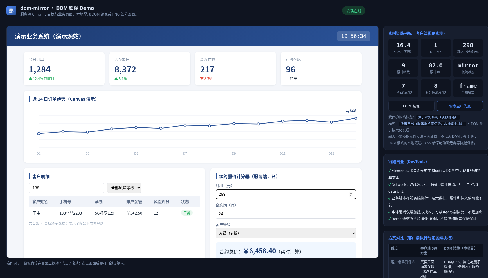

# Demo guide / Demo 实例说明

[English README](README.md) · [中文 README](README.zh-CN.md) · [API reference / 接入 API](docs/API.md)

## English

The standalone Demo wraps the library; it is not a separate gateway product. It runs `demo/server.js`, hosts the built-in source on loopback, and serves the mirroring client. The current interface is Chinese. All customer records, indicators and signing constants are synthetic; no login or external service is required.

### Start and explore

```bash
docker build -t dom-mirror:local .
docker run --rm --name dom-mirror-demo \
  --security-opt seccomp=docker/seccomp-chromium.json \
  --memory 2g --cpus 2 \
  -p 127.0.0.1:18088:8088 dom-mirror:local
```

Open **http://127.0.0.1:18088/**. Alternatively, install the dependencies and Chromium, then run `npm run demo` and open **http://127.0.0.1:8088/**. `npm start` remains an alias; `node server.js` now only exports the factory and does not start a service.

1. **Initial view:** DOM mode shows 12 synthetic customer rows, order metrics and a canvas chart. The side panel displays the actual session's live counters, not a benchmark.
2. **Search:** type `138` in the customer search field. One row remains.
3. **Quote:** change monthly rent to `299`; keep 24 months and grade A. The source-side calculation is `299 × 24 × 0.9 = 6,458.40`, and the mirror displays `￥6,458.40`.
4. **Fallback:** click “像素直出兜底” in the right panel. The existing session changes to `frame` and receives PNG tiles. Mirrored DOM remains part of this mode.

### Frame mode: actual capture



Initial DOM view and the keyboard interaction capture are in the [main README](README.md#a-concrete-walkthrough).

### Reproduce the screenshots

The capture script starts its own Demo and Chromium, performs real keyboard and button operations, asserts the results, captures the page, and closes both. The script never rewrites the page to fabricate results. Run it in a disposable container with no external network or published ports:

```bash
mkdir -p docs/assets && chmod a+rwx docs/assets
docker run --rm --name dom-mirror-docs-capture --network none \
  --security-opt seccomp=docker/seccomp-chromium.json \
  --memory 3g --cpus 2 \
  -v "$PWD/docs/assets:/captures" \
  -e SCREENSHOT_DIR=/captures \
  dom-mirror:local timeout 150 node tools/capture-demo.cjs
```

Output: `demo-dom.png`, `demo-interaction.png`, `demo-frame.png` and [demo-capture.json](docs/assets/demo-capture.json). The report records the source version, capture time, viewport, assertions and observed PNG tile messages. Overview captures include the horizontally overflowing Demo side panel and stop at 960px height; the interaction image captures just the mirror pane. The browser viewport is 1280×900 at DPR 1. UI counters, clock and chart may differ between runs. This is a local synthetic-page walkthrough, not a production, cross-network or capacity test.

## 中文

Demo 是依赖包的独立体验入口，不是完整网关产品。`demo/server.js` 负责启动内置回环源站和镜像客户端；界面为中文，客户记录、指标及签名常量全部为合成数据，不需要登录或外部服务。

### 操作步骤

使用上方 Docker 命令构建运行，访问 **http://127.0.0.1:18088/**。本地安装依赖和 Chromium 后也可运行 `npm run demo`，访问 **http://127.0.0.1:8088/**。`npm start` 仍为兼容别名；直接 `node server.js` 不再启动服务。

1. **初始页面**：DOM 模式显示 12 条合成客户记录、订单指标和 Canvas 图表；右侧实时指标不是性能基准。
2. **搜索筛选**：客户搜索输入 `138`，应剩 1 条记录。
3. **报价计算**：月租改为 `299`，保留 24 个月和 A 级，源站计算 `299 × 24 × 0.9`，镜像结果应为 `￥6,458.40`。
4. **模式切换**：点击右侧“像素直出兜底”，原会话切为 `frame` 并接收 PNG 条带，仍包含镜像 DOM。上方为真实 frame 截图，DOM 初始及交互后截图见[中文 README](README.zh-CN.md#一个完整的演示实例)。

### 截图复现与范围

上方截图命令使用一次性容器，无外网、无宿主端口映射，脚本自动启动 Demo、操作、断言、截图并清理；不会注入伪造的业务结果。JSON 记录版本、时间、视口和断言。浏览器视口为 1280×900、DPR 1；概览图包含横向溢出的右侧面板，截取至 960px 高度；交互图仅截取镜像面板。时钟、图表和实时计数随运行变化；此演示不等同于生产、跨网络、容量或任意业务兼容验收。

## Demo configuration / Demo 配置

These environment variables are read by the **Demo**. Library consumers pass [factory options](docs/API.md) instead.

以下环境变量由 Demo 读取；依赖包宿主直接传入工厂参数。

| Variable / 变量 | Default / 默认 | Meaning / 含义 |
| --- | --- | --- |
| `DEMO_PORT` | `8088` | Client HTTP/WS port, binds `0.0.0.0` / 镜像端口 |
| `ORIGIN_PORT` | `8077` | Built-in source, loopback only / 内置回环源站，指定外部源站后仍启动 |
| `ORIGIN_URL` | `http://127.0.0.1:8077/` | Initial source URL / 初始源站 |
| `DEFAULT_MODE` | `dom` | `dom` or `frame`; other values fail validation / 无效值拒绝启动 |
| `MAX_SESSIONS` | `3` | Active plus retained sessions / 活跃与保留会话总上限 |
| `SESSION_GRACE_MS` | `60000` | Integer 0–300000 ms / 断线保留毫秒数，0 不保留 |
| `VIEW_W` / `VIEW_H` | `1280` / `800` | Initial viewport, then adjusted by client / 初始视口 |
| `OBFUSCATE` | enabled if pool exists | `0` disables / 无字体池时降级，`0` 关闭 |
| `CHROMIUM_SANDBOX` | `1` | `0` disables the Chromium sandbox (unsafe) / `0` 关闭 Chromium sandbox（不安全） |
| `PROD_PRESENTATION` | `0` | `1` hides Demo chrome; adds no security / 仅隐藏演示面板 |
| `RBI_ALLOWED_ORIGINS` | empty / 空 | Allowed source origins for the trusted `x-rbi-origin` header; not WS Origin policy |
| `PUPPETEER_EXECUTABLE_PATH` | Puppeteer-managed | Browser executable / 浏览器路径 |

To mirror your source with the Demo / 接入其他源站：

```bash
docker run --rm -p 127.0.0.1:18088:8088 \
  --security-opt seccomp=docker/seccomp-chromium.json \
  -e ORIGIN_URL=https://your-site.example/ \
  -e DEFAULT_MODE=dom dom-mirror:local
```

The source must be reachable from inside the container; its `127.0.0.1` is the container itself. Use one fixed source per instance; dynamic multi-source asset routing is incomplete. Gateways must strip user-supplied `x-rbi-origin`, inject it only from trusted code, and configure `RBI_ALLOWED_ORIGINS`.

容器内 `127.0.0.1` 指向容器自身，源站必须可达。建议每实例固定一个源站；多源站资源路由尚不完整。网关需剥除访客同名 `x-rbi-origin` 头，仅由可信代码注入，并配置允许源站列表。

Resource limits above are examples, not capacity guarantees. The Demo has no entry authentication. Its current Chromium sandbox, data exposure and compatibility limits still apply; see [security](README.md#security-and-compatibility) / [安全边界](README.zh-CN.md#安全边界).
