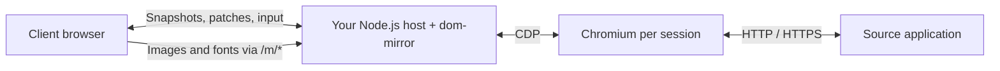
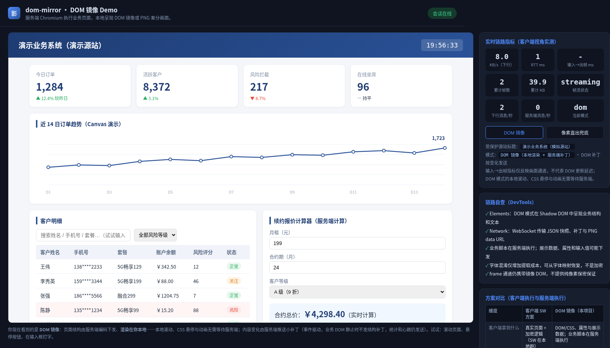
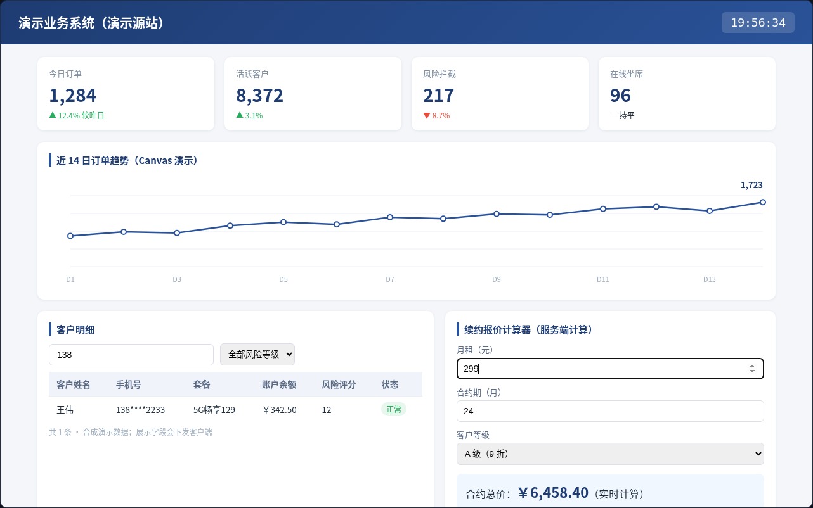

<p align="center">
  
</p>
<h1 align="center">dom-mirror</h1>
<p align="center">Run the page on the server. Mirror its DOM in the browser.</p>
<p align="center"><strong>English</strong> · <a href="README.zh-CN.md">简体中文</a></p>

A **Node.js library** for embedding remote browser mirroring into your own application. Each session runs an independent Chromium; the client receives DOM/CSS snapshots and incremental updates, renders them locally, and sends interactions back. A standalone Demo is included for exploration and regression testing.

**Source version: 0.27.0 · Node.js ≥ 22.12 · Apache-2.0**

The source version does not imply an npm release. This is an experimental library, with the compatibility and security boundaries described below.


## How it works



| Mode | What happens |
| --- | --- |
| **`dom`** — default | Cleaned DOM/CSS is rendered in a client-side Shadow DOM. Mutations become patches; canvas content is captured as needed. |
| **`frame`** — fallback | Chromium-generated PNG tiles provide the page appearance. Mirrored DOM and the interaction pipeline are still present. |

- **Local rendering:** DOM-mode scrolling, CSS hover and animations can run locally; business interactions are sent back to Chromium.
- **Incremental updates:** structure changes are coalesced into patches. Statistics and heartbeats still generate traffic on an otherwise static page.
- **Short reconnects:** the same page can resume its in-memory browser session after a brief WebSocket interruption. Commands are never automatically replayed.
- **Explicit ownership:** importing the package starts no listeners or browsers. The host creates instances and closes them explicitly.
- **Optional font obfuscation:** available with a separately built font pool; it is not encryption.

## Embed the library

Build an installable tarball from this checkout:

```bash
git clone https://github.com/yibanban663/dom-mirror.git
cd dom-mirror
PUPPETEER_SKIP_DOWNLOAD=true npm ci
npm pack
```

Install the generated file in your host project:

```bash
npm install /path/to/lizhen-xxaq-dom-mirror-0.27.0.tgz
```

Chromium and its system libraries must be available in the host environment. If your environment manages Chromium separately, use `PUPPETEER_SKIP_DOWNLOAD=true` during installation and pass its path through `launchOptions.executablePath`.

```js
const http = require('node:http');
const { createMirror } = require('@lizhen-xxaq/dom-mirror');

const mirror = createMirror({
  originUrl: 'https://your-site.example/',
  maxSessions: 3,
  sessionGraceMs: 60_000,
  redactAttributes: ['data-private'], // Optional host-owned metadata.
});

const server = http.createServer(mirror.handleRequest);
server.on('upgrade', mirror.handleUpgrade);
server.listen(8088, '127.0.0.1');

// During host shutdown, stop accepting requests, await mirror.close(),
// then finish closing the host's HTTP connections.
```

`createMirror()` is lazy: Chromium starts only for a valid session. Instances have independent session stores and limits. `close()` is idempotent, waits for session cleanup and late browser startup, and leaves the host HTTP server under the host's control. TypeScript declarations are included.

The built-in client currently requires **the root path of a dedicated origin**, with `/ws`, `/m/*` and `/f/*`. Arbitrary subpath mounting is not supported. Authentication, TLS and WebSocket Origin checks belong in the host, before these handlers are called.

See the [complete host example](examples/host.cjs), [API reference and migration notes — Chinese](docs/API.md), and [WebSocket protocol — Chinese](docs/PROTOCOL.md).

New in 0.27: stable node IDs, IME, uploads/downloads, Shadow DOM/iframe handling and canvas fidelity regressions. Uploads use 32 KiB raw chunks with per-session byte, concurrency and expiry budgets. Node-side cross-origin iframe fetching is disabled unless the host explicitly sets `crossOriginFrameOrigins`; it shares the field-redaction policy. Hosts still control outbound network access. See the [API limits](docs/API.md).

## Run the Demo

The original standalone startup is now the **Demo**, not the package API. `npm start`, `npm run demo` and the Docker default all run `demo/server.js`.

### Docker

```bash
docker build -t dom-mirror:local .
docker run --rm --name dom-mirror-demo \
  --security-opt seccomp=docker/seccomp-chromium.json \
  --memory 2g --cpus 2 \
  -p 127.0.0.1:18088:8088 dom-mirror:local
```

Open **http://127.0.0.1:18088/**. The built-in source is a synthetic customer dashboard: orders, a canvas chart, customer search and a renewal quote calculator. It requires no login and contains no real business records. The current Demo interface is Chinese; both README files describe the same implementation.

### From source

```bash
npm ci
npx puppeteer browsers install chrome
npm run demo
```

Open **http://127.0.0.1:8088/**. Chromium's system libraries are also required; the Docker image already includes them. To mirror a different source, set `ORIGIN_URL` when starting the Demo. The source must be reachable from the server/container.

### A concrete walkthrough

| Step | Action | Expected result |
| --- | --- | --- |
| 1 | Open the Demo in DOM mode | The customer table contains **12** synthetic rows. |
| 2 | Type `138` in the customer search field | The table filters to **1** row. |
| 3 | Set monthly rent to `299`, leaving 24 months and grade A | The server-side calculator returns **￥6,458.40**. |
| 4 | Click the PNG fallback / `frame` button | The existing session switches to PNG appearance updates. It still carries mirrored DOM. |

**DOM mode — actual local capture:**



**After real keyboard input — one matching customer and the updated quote:**



See the [Demo guide](README.demo.md) for the frame screenshot, configuration, capture provenance and the exact reproduction command. These are real browser captures, not generated UI mockups. They demonstrate this synthetic page, not general application compatibility or performance guarantees.

## Session and host boundaries

- A disconnected session is retained for **60 seconds by default**, starting when the server detects disconnection. Retained sessions count against `maxSessions`.
- Resume tokens stay in the current page's memory. Reloading the page, reopening it, a process restart or Chromium exit does not restore the session.
- Unacknowledged business operations must be checked against the source application; inputs, clicks and submissions are not replayed.
- Hosts can bind resume to a verified user/tenant key with `getSessionIdentity(req)`. Without this opt-in hook, the instance remains anonymous. Client-supplied identity fields are not trusted.
- The host owns authentication, TLS, rate limits, user quotas and deployment. The package supplies the mirror engine and its lifecycle; it is not a complete gateway product.

The identity hook rejects missing identities before WS upgrade and prevents another host identity from using a known resume token. It does not authenticate HTTP resource requests or automatically revoke open connections. On logout or permission changes, first deny admission with the old host credentials, then call `await mirror.revokeIdentity(identity)` to end that identity's current sessions, or `await mirror.revokeSession(token)` for one session. These methods invalidate resume tokens and await page/browser cleanup. See the [API contract](docs/API.md#宿主主动撤销).

## Security and compatibility

**Treat the current Demo as a controlled validation environment.**

This layer does not repair authorization, injection or business-logic flaws in the source application. If the source remains directly reachable by untrusted clients, they may bypass the mirror. Reduced client-side visibility is not evidence of resistance to a penetration test; no general scanner effectiveness result is claimed.

- Displayed text, DOM/CSS, attributes, ordinary input values and hidden DOM text may reach the client. There is no promise that all business data stays on the server.
- `frame` is **not a DOM-free pixel-only channel**. Font obfuscation is reversible and is not encryption.
- HTML cleanup is not an audited general-purpose sanitizer. Static asset filtering is not a complete navigation, subresource or network access policy.
- There is no built-in authentication provider, rate limiting or WS Origin validation. Hosts must implement these controls; the optional identity hook consumes the host's verified identity.
- Default Chromium arguments include `--no-sandbox`; the Demo Docker image runs as root. Browser and network isolation need additional hardening for untrusted content.
- Uploads/downloads, clipboard, popups, IME, iframes, Shadow DOM, rich text and virtual scrolling do not have complete compatibility guarantees.
- Each session owns a Chromium instance. The default limit of three is configuration; synthetic concurrency tests do not establish general application capacity.

Hidden input `value` attributes are excluded from mirrored snapshots and patches by default. Hosts can additionally remove named attributes with `redactAttributes`; the source page is unchanged. This does not filter hidden text, CSS, resource bodies or pixels. See the [measured data boundary](docs/acceptance/data-boundary-2026-10-26.md) for the observations and limits.

## Development and evidence

```bash
npm run check
npm test
node tools/verify-package.cjs

# After building the current Docker image:
IMAGE=dom-mirror:local bash tools/verify-docker-package-business.sh
IMAGE=dom-mirror:local bash tools/verify-docker-scroll.sh
IMAGE=dom-mirror:local bash tools/verify-docker-data-boundary.sh
IMAGE=dom-mirror:local bash tools/verify-docker-session-identity.sh
IMAGE=dom-mirror:local bash tools/verify-docker-session-revocation.sh
IMAGE=dom-mirror:local bash tools/verify-docker-vikunja.sh
IMAGE=dom-mirror:local SESSION_GRACE_MS=2000 \
  BUSINESS_TEST_SCRIPT=verify-recovery.cjs EVIDENCE_DIR=artifacts/recovery \
  bash tools/verify-docker-vikunja.sh
```

The fast tarball check installs the package without launching Chromium. `verify-docker-package-business.sh` additionally installs a fresh tarball in an independent consumer, removes the source runtime, disables `NODE_PATH` fallback and verifies installed file hashes. It runs real Vikunja login, task creation, priority changes and completion with independent persistence assertions, then tests recovery, expiry and browser cleanup. Closing the mirror must preserve the host HTTP service. Browser tests use isolated Docker networks; CI retains the archive identity, consumer dependency lock, results and screenshots. See the [packaged business acceptance record](docs/acceptance/package-business-2026-10-26.md); use the CI result for the relevant commit.

The frame codec reuses decoded pixels for ordinary RGB/RGBA PNG crops and falls back for other encodings. Measurements show a **local encoding benefit**, not a demonstrated stable end-to-end speedup. [Synthetic concurrency tests](docs/performance/2026-10-26-capacity.md) cover 1/3/6 sessions in DOM and frame: DOM meets this experiment's budgets; frame does not consistently meet the post-cleanup anonymous-memory budget (one single-session run and both 3/6-session runs exceed it). A [ten-cycle memory investigation](docs/performance/2026-10-26-frame-memory.md) finds that forced GC and disabling sharp cache do not resolve the retained anonymous memory; allocator controls are a host-level diagnostic, not a package default. Real-application capacity and sustained operation remain to be validated.

A [30-cycle native-memory follow-up](docs/performance/2026-10-26-frame-memory-long.md) passed 900 operations but failed the normal cleanup-memory budget in all 30 cycles. A terminal GC/trim diagnostic confirmed about 41MiB of reclaimable residency; it is not enabled by the library. A [matched host-profile comparison](docs/performance/2026-10-26-allocator-mappings.md) passed the cleanup-memory budget in 1/10 glibc cycles and 10/10 jemalloc-with-decay cycles; a [30-cycle follow-up](docs/performance/2026-10-26-jemalloc-candidate.md) passed 900 operations but only 17/30 normal cleanup-memory budgets. Vikunja core flows and DOM/frame recovery passed with that host profile; the candidate is not qualified for production.

A [V8 host-profile follow-up](docs/performance/2026-10-26-v8-memory.md) found that moving diagnostic history to disk did not fix the budget misses. An explicit host semi-space limit of 4MiB passed all 30 cleanup-memory budgets (maximum growth 26.8MiB), with Vikunja core/recovery flows passing too. This is a tested host option for the recorded three-session workload; library defaults and production-qualification limits are unchanged.

Further reading: [roadmap](docs/ROADMAP.md) · [Vikunja acceptance](docs/acceptance/vikunja-2026-10-26.md) · [recovery acceptance](docs/acceptance/recovery-2026-10-26.md) · [codec acceptance](docs/acceptance/frame-codec-0.10.1.md) · [performance investigation](docs/performance/2026-10-26.md) · [font setup](docs/FONTS.md) · [changelog](CHANGELOG.md). These historical reports identify the versions they tested.

## License

Code: [Apache-2.0](LICENSE). Bundled Noto Sans SC fonts: [SIL OFL 1.1](assets/FONT-OFL-LICENSE.txt). Supplied fonts must have suitable redistribution rights. Logo and illustration sources are documented in [visual asset notes](docs/assets/README.md).
