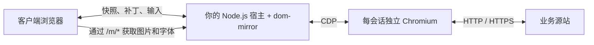

<p align="center">
  
</p>
<h1 align="center">dom-mirror</h1>
<p align="center">页面运行在服务端，DOM 镜像呈现在浏览器。</p>
<p align="center"><a href="README.md">English</a> · <strong>简体中文</strong></p>

供宿主应用嵌入的 **Node.js 远程浏览器 DOM 镜像包**。每个会话运行独立 Chromium；客户端接收 DOM/CSS 快照和增量更新，在本地渲染并回传交互。仓库附带独立 Demo，用于体验与回归验证。

**源码版本：0.27.0 · Node.js ≥ 22.12 · Apache-2.0**

源码版本不代表已发布 npm。当前为实验阶段的依赖包，兼容性与安全边界见下文。


## 工作方式



| 模式 | 行为 |
| --- | --- |
| **`dom`** — 默认 | 清理后的 DOM/CSS 在客户端 Shadow DOM 中渲染；结构变化形成补丁，canvas 内容按需捕获。 |
| **`frame`** — 兜底 | Chromium 生成的 PNG 条带提供页面外观，仍保留镜像 DOM 和交互管线。 |

- **本地渲染**：DOM 模式的滚动、CSS 悬停和动画可在本地执行，业务交互回传 Chromium。
- **增量更新**：结构变化合并为补丁；静止页面仍会产生统计与心跳流量。
- **短时恢复**：同一页面可在短暂 WS 中断后恢复内存中的浏览器会话，业务命令不会自动重放。
- **显式生命周期**：引入包不监听端口或启动浏览器，由宿主创建并关闭实例。
- **可选字体混淆**：需要单独构建字体池，不提供加密保证。

## 作为依赖接入

先从当前源码构建可安装的 tarball：

```bash
git clone https://github.com/yibanban663/dom-mirror.git
cd dom-mirror
PUPPETEER_SKIP_DOWNLOAD=true npm ci
npm pack
```

在宿主项目安装生成的文件：

```bash
npm install /path/to/lizhen-xxaq-dom-mirror-0.27.0.tgz
```

宿主环境需要 Chromium 及其系统库。若由环境单独管理 Chromium，可在安装时设置 `PUPPETEER_SKIP_DOWNLOAD=true`，并通过 `launchOptions.executablePath` 传入浏览器路径。

```js
const http = require('node:http');
const { createMirror } = require('@lizhen-xxaq/dom-mirror');

const mirror = createMirror({
  originUrl: 'https://your-site.example/',
  maxSessions: 3,
  sessionGraceMs: 60_000,
  redactAttributes: ['data-private'], // 可选：剔除宿主定义的私有属性。
});

const server = http.createServer(mirror.handleRequest);
server.on('upgrade', mirror.handleUpgrade);
server.listen(8088, '127.0.0.1');

// 宿主停机时：停止接入新请求，await mirror.close()，
// 然后完成宿主 HTTP 连接的关闭。
```

`createMirror()` 惰性启动 Chromium：只有有效会话才创建浏览器。实例的会话存储和容量上限独立；`close()` 幂等，等待会话清理及晚启动的浏览器回收，不关闭宿主 HTTP 服务。包内附带 TypeScript 类型声明。

当前内置客户端要求挂载在**独立 origin 的根路径**，使用 `/ws`、`/m/*` 和 `/f/*`，尚不支持任意子路径挂载。宿主应在调用处理器之前完成鉴权、TLS 与 WebSocket Origin 校验。

详见[完整宿主示例](examples/host.cjs)、[API 与迁移说明](docs/API.md)和 [WebSocket 协议](docs/PROTOCOL.md)。

0.27 新增稳定节点 ID、IME、上传下载、Shadow DOM/iframe 和 canvas 兼容回归。上传使用 32KiB 原始分块，并限制会话总量、并发与过期；Node 侧跨源 iframe 抓取默认关闭，需宿主显式配置 `crossOriginFrameOrigins`，下发内容复用字段过滤策略。宿主仍须限制出站网络。具体限制见 [API 文档](docs/API.md)。

## 运行 Demo

原独立启动方式现在属于 **Demo**，不属于包 API。`npm start`、`npm run demo` 和默认 Docker 命令均运行 `demo/server.js`。

### Docker

```bash
docker build -t dom-mirror:local .
docker run --rm --name dom-mirror-demo \
  --memory 2g --cpus 2 \
  -p 127.0.0.1:18088:8088 dom-mirror:local
```

访问 **http://127.0.0.1:18088/**。内置源站是合成客户看板，包含订单指标、Canvas 图表、客户搜索及续约报价计算器，不需要登录，也不含真实业务记录。当前 Demo 界面为中文，两份 README 对应同一实现。

### 本地源码

```bash
npm ci
npx puppeteer browsers install chrome
npm run demo
```

访问 **http://127.0.0.1:8088/**。本机还需安装 Chromium 系统库；Docker 镜像已包含这些依赖。通过 `ORIGIN_URL` 可指定其他源站，但源站必须能从服务端或容器内访问。

### 一个完整的演示实例

| 步骤 | 操作 | 预期结果 |
| --- | --- | --- |
| 1 | 打开 Demo，保持默认 DOM 模式 | 客户表显示 **12 条**合成记录。 |
| 2 | 在客户搜索框输入 `138` | 表格筛选为 **1 条**记录。 |
| 3 | 将月租改为 `299`，保留 24 个月和 A 级 | 服务端报价更新为 **￥6,458.40**。 |
| 4 | 点击“像素直出兜底”按钮 | 原会话切换为 `frame`，接收 PNG 外观更新，仍保留镜像 DOM。 |

**DOM 模式：本地真实运行截图。**


**真实键盘操作后：筛选出一名客户，并更新报价。**


[Demo 说明](README.demo.md)包含 frame 模式截图、配置项、截图来源和完整复现命令。截图来自真实浏览器，不是生成的 UI 样机；只说明该合成页面的运行情况，不代表任意业务兼容或性能保证。

## 会话与宿主边界

- 默认从服务端检测到断线起保留会话 **60 秒**，保留中的会话仍占用 `maxSessions` 名额。
- 恢复凭据只保存在当前页面内存中；刷新、重新打开页面、进程重启及 Chromium 退出后不可恢复。
- 对尚未确认的业务操作，应先核对源站记录；输入、点击和提交不会自动重放。
- 宿主可用 `getSessionIdentity(req)` 将恢复绑定到已验证的用户/租户键；未配置时仍为匿名模式，不信任客户端附带的身份字段。
- 鉴权、TLS、限流、用户配额和部署由宿主负责；本包提供镜像引擎与生命周期，不建设完整网关产品。

身份回调在 WS 升级前拒绝缺失身份，并阻止其他宿主身份使用已知恢复 token；它不保护 HTTP 资源，也不会自动撤销已有连接。注销或权限变化时，宿主应先阻止旧凭据继续入场，再调用 `await mirror.revokeIdentity(identity)` 终止该身份的现有会话；也可用 `await mirror.revokeSession(token)` 撤销单个会话。接口作废恢复 token 并等待页面与浏览器清理，详见[接入 API](docs/API.md#宿主主动撤销)。

## 安全边界

**当前 Demo 适用于受控验证环境。**

本层不会修复源站的权限、注入或业务逻辑漏洞。若不可信客户端仍能直连源站，也可能绕过镜像。减少客户端可见信息，不等于已证明能抵御渗透测试；目前没有通用扫描器防护效果结论。

- 展示文本、DOM/CSS、属性、普通输入值及隐藏 DOM 文本可能下发，不能承诺所有业务数据都留在服务端。
- `frame` **不是不下发 DOM 的纯像素通道**；字体混淆可逆，不是加密。
- HTML 清理尚未经完整 sanitizer 安全验证；静态资源过滤也不是完整的导航、子资源和网络访问策略。
- 没有内建鉴权提供方、限流或 WS Origin 校验，需要宿主实现；可选身份回调只消费宿主已验证的身份。
- 默认 Chromium 参数包含 `--no-sandbox`，Demo Docker 以 root 运行；处理不可信内容前需要进一步加固浏览器与网络隔离。
- 上传下载、剪贴板、弹窗、IME、iframe、Shadow DOM、富文本及虚拟滚动尚无完整兼容性保证。
- 每会话独立 Chromium。默认三会话是配置上限；合成并发测试不构成通用业务容量保证。

默认从镜像快照和补丁中移除隐藏 input 的 `value`；宿主还可用 `redactAttributes` 剔除指定属性，源站原页面不改写。该机制不会过滤隐藏文本、CSS、资源正文或像素。具体观察和限制见[数据下发边界验收](docs/acceptance/data-boundary-2026-10-26.md)。

## 开发与验收

```bash
npm run check
npm test
node tools/verify-package.cjs

# 从当前源码构建 Docker 镜像后：
IMAGE=dom-mirror:local bash tools/verify-docker-package-business.sh
IMAGE=dom-mirror:local bash tools/verify-docker-scroll.sh
IMAGE=dom-mirror:local bash tools/verify-docker-data-boundary.sh
IMAGE=dom-mirror:local bash tools/verify-docker-session-identity.sh
IMAGE=dom-mirror:local bash tools/verify-docker-session-revocation.sh
IMAGE=dom-mirror:local bash tools/verify-docker-vikunja.sh
IMAGE=dom-mirror:local SESSION_GRACE_MS=2000 \
  BUSINESS_TEST_SCRIPT=verify-recovery.cjs EVIDENCE_DIR=artifacts/recovery \
  bash tools/verify-docker-vikunja.sh
```

快速 tarball 检查不启动 Chromium；`verify-docker-package-business.sh` 则将新打包产物安装到独立宿主，移除源码运行目录、禁用 `NODE_PATH` 回退并校验安装文件哈希。随后通过真实浏览器验证 Vikunja 登录、创建、优先级和完成，独立检查持久化，再检查恢复、过期及浏览器回收；关闭镜像实例后宿主 HTTP 仍须存活。浏览器测试使用隔离 Docker 网络，CI 保存包身份、消费端依赖锁、结果和截图。具体结果见[打包产物验收](docs/acceptance/package-business-2026-10-26.md)，远端是否通过以对应提交结果为准。

frame 编码会复用普通 RGB/RGBA PNG 的解码像素，对其他编码保守回退。测量证明了**局部编码收益**，尚未证明稳定的端到端提速。[合成并发测试](docs/performance/2026-10-26-capacity.md)已覆盖 DOM/frame 的 1/3/6 会话：DOM 满足本轮预算，frame 回收后匿名内存预算未稳定通过（单会话一轮略超，3/6 会话均超）。[十轮内存调查](docs/performance/2026-10-26-frame-memory.md)确认强制 GC 和关闭 sharp cache 均未解决匿名内存驻留；分配器参数属于宿主诊断选项，不设为包的默认行为。真实业务容量与长期运行仍待验收。

[三十轮原生内存续测](docs/performance/2026-10-26-frame-memory-long.md)完成 900 次操作，但正常回收内存预算 0/30 轮通过。末尾 GC/trim 诊断确认约 41MiB 可归还驻留，库中没有启用该干预。[同镜像宿主配置对照](docs/performance/2026-10-26-allocator-mappings.md)中，glibc 回收内存预算通过 1/10 轮，jemalloc 加后台回收配置通过 10/10 轮；后续[三十轮候选验收](docs/performance/2026-10-26-jemalloc-candidate.md)完成 900 次操作，但正常回收内存预算仅通过 17/30 轮，同配置下的 Vikunja 核心流程及 DOM/frame 恢复通过；候选配置尚未满足生产准入。

[V8 宿主配置续测](docs/performance/2026-10-26-v8-memory.md)确认仅将诊断历史落盘不足以修复超预算；宿主显式限制 semi-space 为 4MiB 后，正常回收预算通过 30/30 轮（最大增长 26.8MiB），Vikunja 核心与恢复流程也通过。这是记录中的三会话负载验证过的宿主选项，库默认行为和生产准入边界保持不变。

更多资料：[路线图](docs/ROADMAP.md) · [Vikunja 验收](docs/acceptance/vikunja-2026-10-26.md) · [恢复验收](docs/acceptance/recovery-2026-10-26.md) · [编码优化验收](docs/acceptance/frame-codec-0.10.1.md) · [性能调查](docs/performance/2026-10-26.md) · [字体配置](docs/FONTS.md) · [变更记录](CHANGELOG.md)。历史报告中的结果仅对应其明确标注的版本。

## 许可证

代码采用 [Apache-2.0](LICENSE)，内置 Noto Sans SC 字体采用 [SIL OFL 1.1](assets/FONT-OFL-LICENSE.txt)。自备字体需具备相应再分发许可。Logo 与配图来源见[视觉资源说明](docs/assets/README.md)。
