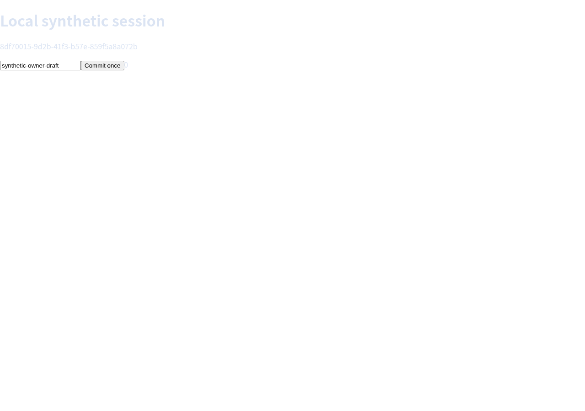
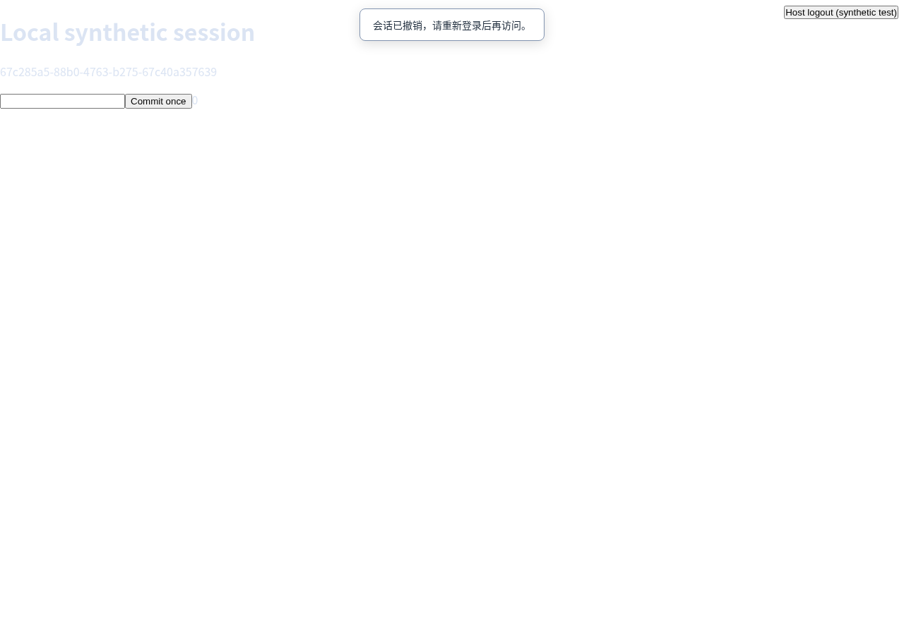

# 宿主注销与会话撤销：真实 Chromium 验收

2026-10-26，本地隔离合成宿主的 DOM / frame 两组均通过。工作区基于 `cabaf4b`，并包含主动撤销关闭通知与客户端状态修复；具体引擎、客户端和脚本摘要见机器可读结果。本轮增加验收脚本和 CI。机器可读结果及源码/脚本摘要见 [session-revocation-summary.json](session-revocation-summary.json)。

## 操作与独立证据

使用随机测试凭据登录宿主，在真实浏览器中输入草稿并点击一次提交；独立源站事件记录确认草稿和计数。随后断开并恢复原会话，确认仍是原草稿，再创建同身份的另一在线会话、断线保留会话、另一用户与另一租户的对照会话。

在真实客户端页面添加测试专用的宿主注销按钮，使用 Puppeteer 鼠标点击。宿主先从凭据表删除该身份的凭据，再等待 `mirror.revokeIdentity(identity)`。该按钮及登录/注销路由只属于合成夹具，不是本包自带的用户系统。期间还保留一个已通过鉴权但尚未发送 hello 的 WS，验证握手窗口。

| 检查 | DOM | frame |
|---|---|---|
| 注销前真实 UI 输入、一次提交、恢复保留草稿 | 通过 | 通过 |
| 注销返回逻辑会话数 | 3 | 3 |
| 原在线连接、同身份在线连接关闭 | 通过 | 通过 |
| 同身份待握手连接关闭（不计入逻辑会话数） | 通过 | 通过 |
| 原凭据新建连接或恢复 | HTTP 401 | HTTP 401 |
| 同身份换用有效新凭据，恢复旧在线/保留 token | SESSION_EXPIRED | SESSION_EXPIRED |
| 被撤销的 3 个浏览器：页面关闭、连接断开、子进程退出且 `/proc/PID` 消失 | 全部通过 | 全部通过 |
| 另一用户、另一租户 | 页面和浏览器仍存在，WS 可响应 ping | 同左 |
| 单独 revokeSession：连接关闭、页面/进程回收、旧 token 不可恢复 | 通过 | 通过 |
| 重复撤销 | false / 0 | false / 0 |
| 重新登录并新建会话 | 独立页面，无旧草稿 | 同左 |
| 客户端收到撤销关闭码 | 4001 | 4001 |
| 撤销提示、交互冻结、隐藏直接新建按钮 | 通过 | 通过 |
| 注销后 6 秒观察窗内自动/重连按钮触发的新升级次数 | 0 | 0 |
| 普通短时断线自动恢复并保留同一源站页面 | 通过 | 通过 |
| 源站业务提交额外重放次数 | 0 | 0 |

每组启动 6 个服务端业务 Chromium，资源检查直接跟踪 Puppeteer 创建的真实子进程和页面；仅包装启动/关闭以收集证据，没有替换浏览器。另有独立客户端 Chromium 操作宿主页面。

DOM 模式注销前的真实输入与提交：



DOM 模式点击宿主注销按钮后：



[frame 注销前](../assets/revocation-frame-before.png)和[注销后](../assets/revocation-frame-after.png)也保存了实际截图。截图只证明可见状态；权限和资源结论来自 WS、宿主响应、源站事件以及子进程检查。

## 环境与复现

Chrome `156.0.8078.47`，锁定依赖 Puppeteer `25.16.0`、sharp `0.35.5`、ws `8.22.0`。本地复用版本未变的依赖运行时 `dom-mirror:identity`，复制当前源代码并运行 `npm ls --omit=dev`；镜像 ID 在摘要内。这不等于本轮完成标准 Dockerfile 的全新在线依赖安装。

```bash
docker build -t dom-mirror:local .
IMAGE=dom-mirror:local bash tools/verify-docker-session-revocation.sh
```

脚本在 `--network none`、3 GiB / 2 CPU、300 秒上限的临时容器中自行启动 loopback 源站与宿主，不发布端口，不连接已有业务。默认输出到 `artifacts/session-revocation/`，包含镜像 ID、运行日志、结果 JSON 和 4 张截图；容器结束后删除。凭据和恢复 token 不写入证据。

本地原始证据为 `/home/Kei/dom-mirror-validation/20261026/session-revocation/final/`，运行返回 0，临时容器已清理。CI 已接入同一脚本及证据上传；本轮尚未推送或执行远端 CI。

Node 编译与 27 项测试通过，其中包含对端不处理关闭帧时，服务端在 1 秒握手等待后强制回收的回归。普通断线和撤销各走不同状态，客户端对照检查先关闭普通连接并自动恢复到同一源站页面，再注销，最终只记录关闭码 `[1000, 4001]`，没有注销后的额外连接。

## 已知边界

- 宿主必须先拒绝旧凭据，再主动调用撤销接口；身份回调不持续重验已有连接。仅删除凭据不会自动结束已有会话，历史[身份边界验收](session-identity-2026-10-26.md)仍然成立。
- 首次运行发现客户端仍显示“正在恢复”并重试，现已修复：健康连接发送 `4001 / SESSION_REVOKED`，客户端清除恢复 token、明确显示撤销并停止重连。本次对 6 秒内的客户端连接构造次数和宿主升级次数双重断言；不将有限观察窗当作长稳或容量结论。若链路异常导致关闭码未送达，客户端仍可能显示通用断线提示，服务器端凭据拒绝与 token 作废继续生效。
- 这是合成宿主的实际 Chromium 验收，没有复跑 Vikunja 的应用注销流程，也没有证明真实账号提供方、跨实例广播、长期容量或进程崩溃恢复。
- 页面回收和 token 作废不会撤回已经提交的业务、清除客户端已经看到的信息，或注销源站自身的凭据。
