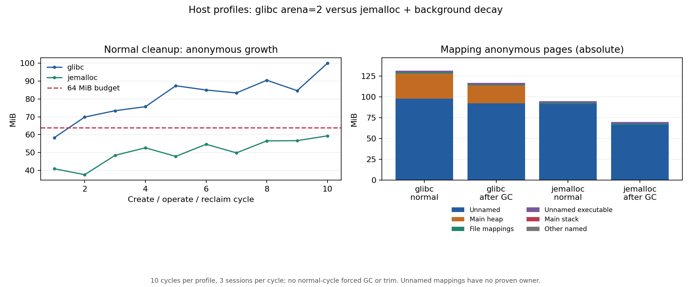

# 宿主 allocator 与匿名映射对照

本轮接续[三十轮调查](2026-10-26-frame-memory-long.md)，比较两套宿主配置，并补 `/proc/self/smaps` 和 V8 heap-space 记录。原 64MiB 回收增长预算不变；不把末尾 GC 后的值算成正常回收通过。

## 对照结果

两组各十轮全部完成，共 60 个独立源站会话 / 600 次唯一操作；功能、回执和浏览器回收检查均通过，无 OOM。两组同一镜像与九项测量源码摘要一致；预检确认实际 Buffer 分配进入 jemalloc，所有 60 个 Chromium 主进程均没有映射 jemalloc。

| 宿主配置 | baseline 匿名 MiB | 第十轮匿名 MiB | 第十轮增长 MiB | 正常增长范围 MiB | 64MiB 预算通过轮次 | 服务端峰值 MiB |
| --- | ---: | ---: | ---: | ---: | ---: | ---: |
| glibc arena=2 | 31.64 | 131.56 | 99.92 | 58.37–99.92 | 1/10 | 814.95 |
| jemalloc + 后台 decay | 35.36 | 94.73 | 59.37 | 37.71–59.37 | 10/10 | 810.61 |

jemalloc 配置在本次十轮的正常回收预算全部通过，末轮匿名增长比 glibc 少约 40.55MiB；不是靠末尾强制 GC 或 trim 取得通过。但最小预算余量仅约 4.63MiB，末五轮仍有约 1.62MiB/轮的上升斜率，不能称为稳定平台。该结果只支持将它作为候选宿主配置，尚需三十轮、重复顺序及真实业务验收，不能替代先前 glibc 三十轮的失败判定或完整容量矩阵。

## 映射拆分

末尾 GC 后再空闲三秒，smaps 匿名页如下。这里与 cgroup checkpoint 的读数相差约 0.1MiB，来自采样时刻及容器内其他进程；表中统一使用完整 smaps 的 Anonymous 求和。

| 映射类别 | glibc MiB | jemalloc MiB |
| --- | ---: | ---: |
| 未命名、非可执行 | 92.39 | 66.65 |
| 主 heap | 21.35 | 0.00 |
| 未命名、可执行 | 2.18 | 2.25 |
| 文件映射中的匿名页 | 1.02 | 1.04 |
| 主 stack | 0.07 | 0.07 |
| 合计 | 117.02 | 70.01 |

这将驻留主要缩小到主 heap 和未命名映射，但未取得这些未命名区段的完整分配调用栈。同期 V8 heap-space physical 合计分别为 22.66MiB、44.99MiB；V8 的预热/GC 物理状态也有差异，不能把两组全部 RSS 差都算成 glibc 碎片，或把“smaps 匿名减 V8 physical”当作精确的 libvips 占用。

glibc 的回收后 free 与 jemalloc 的 allocated/active/resident 属于不同 allocator 记账，只各自观察：jemalloc 第十轮 allocated 33.15MiB、active 35.41MiB、resident 40.04MiB；末尾 GC 后分别为 12.17、14.46、19.08MiB。jemalloc mapped/retained 是地址空间记账，不能当作物理泄漏量。



[机器可读汇总](2026-10-26-allocator-mappings-summary.json)包含两组全部 checkpoint、allocator 统计、映射分类、最大匿名区段、V8 数据、预检与来源审计。原始日志、完整 smaps 与容器记录在本机 `/home/Kei/dom-mirror-validation/20261026/allocator-matrix/`。本轮未改变生产引擎，不把上述宿主配置设为包默认值。

## trim 后的补充映射

另以 glibc 执行三轮、九个源站会话 / 90 次操作，在末尾两次 GC、一次 trim 后再空闲三秒保存映射。功能、回执、回收与 OOM 门槛均通过，数据独立于十轮对照。补充组启动/baseline 与主组末尾清理短时重叠约 2.4 秒，主组业务负载此前已完成；此补充只用于映射诊断，不用于时延比较。

该进程 cgroup 匿名内存从 baseline 32.09MiB 到诊断后 53.71MiB；smaps Anonymous 为 53.81MiB，其中主 heap 8.32MiB、未命名非执行映射 42.39MiB、未命名可执行映射 2.01MiB、文件匿名页 1.02MiB、主 stack 0.07MiB。同期 V8 heap-space physical 合计约 19.14MiB。最大未命名非执行区段的 RSS 约 1.72MiB，剩余页分散在更多区段，不能只查一个最大的映射就宣布归因完成。

三轮进程没有复现原三十轮 trim 后约 89MiB 的全部驻留，不能用它替代原进程缺失的 smaps，或把那约 57MiB 的 baseline 增长全部归因。现在确认的是宿主配置对驻留有显著影响，并保留了新进程的映射区段；精确到原生分配调用栈及三十轮候选配置验收仍是后续工作。

## 固定范围

- 每组在同一进程内完成十轮，每轮三会话、每会话十次真实输入；预期各 30 个源站会话 / 300 次唯一操作。DOM 结果、实际画布像素与独立源站回执全部确认，不重试或重放。
- 服务端 2 CPU 配额 / 2GiB，独立压测容器 4 CPU / 4GiB，internal 网络，无宿主端口。每轮等待 3000ms 会话保留期、浏览器主进程退出，再空闲 3000ms。
- 两组使用同一镜像、同一引擎及探针源码，固定 libvips concurrency=1、默认 sharp cache。glibc 组设置 `MALLOC_ARENA_MAX=2`；jemalloc 组另设置下方 preload 与回收配置。
- 两个阶段顺序执行，每组十轮；不是随机顺序或多次重复的统计试验。jemalloc 是“allocator 加回收参数”的宿主配置对照，不能把效果全部归于更换库本身。
- 正常轮次无强制 GC、无 trim。结束后额外空闲 15 秒，执行两次诊断 GC，再空闲 3 秒；两组都不执行 trim。
- Chromium 启动环境剥离 `LD_PRELOAD` 和 `MALLOC_CONF`，并在真实 browser 主进程 maps 中检查没有 jemalloc。preload 作用于宿主容器的 Node/timeout 启动链；正常预算分别相对各组 baseline 计算。

候选配置（Linux amd64、glibc 2.36，Debian `libjemalloc2=5.3.0-1`）：

```bash
LD_PRELOAD=/usr/lib/x86_64-linux-gnu/libjemalloc.so.2 \
MALLOC_CONF=narenas:2,background_thread:true,dirty_decay_ms:1000,muzzy_decay_ms:1000 \
VIPS_CONCURRENCY=1 node app.js
```

[sharp 官方安装说明](https://sharp.pixelplumbing.com/install/)讨论了 Linux/glibc 的内存碎片及替代 allocator；配置项含义见 [jemalloc 手册](https://jemalloc.net/jemalloc.3.html)。这是待测宿主配置，不是 npm 包默认行为；不同架构与系统的库路径不同。

## 观测与校验

在 baseline、第十轮 postIdle、末尾 GC 后的 finalSettled 保存完整 smaps 及 V8 heap-space 数据。映射按主 heap、主 stack、未命名、未命名可执行、文件映射和其他命名区分组；解析所有 region 的 `Anonymous`，不把地址空间 Size 当物理占用。未命名区段不能仅凭尺寸认定为 V8、libvips 或线程栈，V8 heap-space 数据也不能与重叠的映射直接相加。

jemalloc 通过 `mallctl` 更新 epoch 后读取 allocated/active/resident/mapped/retained；这些字段与 glibc XML 的 system/free 不等价。jemalloc 组不调用 glibc `malloc_info` 作为其占用统计。`dladdr(malloc)` 在此 Node/x86-64 环境指向可执行文件的 PLT 入口，不能作为 allocator provider 判据，见 [dladdr 的限制](https://man7.org/linux/man-pages/man3/dladdr.3.html)。

正式组之前用独立短进程持有一个真实 64MiB Buffer；jemalloc allocated 必须增加至少 64MiB，并验证预期 allocator 与 maps。该预检不预热正式进程。正式汇总还检查 Chromium 没有映射 jemalloc、两组镜像/源码一致、独立回执、正常/末尾干预次数、浏览器回收及 OOM。

## 复现

```bash
docker build -t dom-mirror:local .
docker build -f tools/Dockerfile.allocator --build-arg BASE_IMAGE=dom-mirror:local \
  -t dom-mirror:allocator .
IMAGE=dom-mirror:allocator EVIDENCE_DIR="$PWD/artifacts/allocator/run-1" \
  bash tools/run-allocator-matrix.sh
```

诊断镜像需要 Debian 包源、gcc 和 Node headers。基础镜像与实际测试平台必须满足冻结计划；本轮沿用固定的缓存依赖基底，新安装的 allocator 版本、镜像与源码摘要另行留档。普通 npm 安装/包导入不安装或加载 jemalloc，也不编译该诊断 helper。

后续[三十轮 jemalloc 候选宿主与真实业务验收](2026-10-26-jemalloc-candidate.md)保持原预算，正常回收通过 17/30 轮；十轮候选结果不代表更长运行通过，原十轮数据保持不变。
