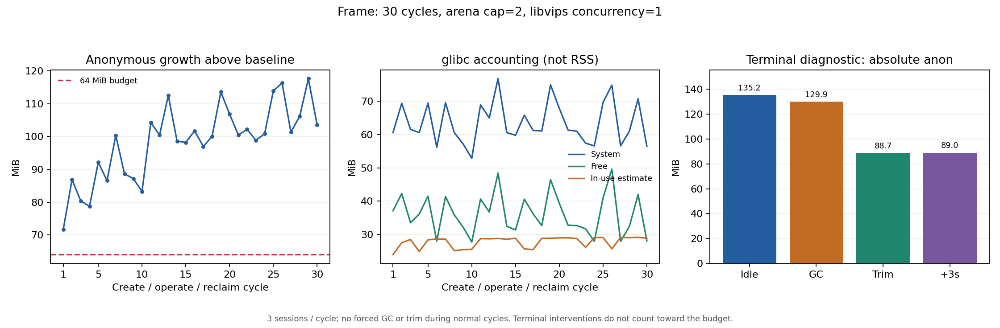

# frame 三十轮回收与原生内存续测

本轮延续[十轮调查](2026-10-26-frame-memory.md)，固定候选 Linux/glibc 宿主配置，观察更多次生命周期后的驻留，并在工作负载全部结束后区分 GC 与 allocator 空闲页归还的效果。原 64MiB 回收增长预算保持不变，末尾诊断后的值不能代替正常回收值。

本轮完成 30 轮、90 个独立源站会话、900 次唯一操作，约 9.6 分钟（含启动、回收、空闲及末尾诊断）；功能与回收检查全部通过，无 OOM。**正常回收预算 0/30 轮通过**。末尾 GC 后匿名内存约 129.89MiB，一次 trim 后降到 88.66MiB，直接确认其中约 41.23MiB 是可归还的空闲页驻留；其余驻留未完全归因，不能宣称长期无泄漏。

## 实测结果

启动 baseline 匿名内存为 31.875MiB。服务端 cgroup 峰值 857.18MiB，所有正常回收 checkpoint 的 sharp queue/process 为 0；跟踪的 90 个 Chromium 主进程均退出。每轮 Node RssAnon 与 cgroup anon 差约 0.094MiB，主要驻留位于 Node 进程，而非残留的浏览器主进程。

| 轮次 | 匿名内存 MiB | 相对 baseline 增长 MiB | heapUsed MiB | external MiB | glibc free MiB | glibc 占用估计 MiB |
| --- | ---: | ---: | ---: | ---: | ---: | ---: |
| 1 | 103.53 | 71.65 | 21.88 | 19.60 | 37.11 | 23.96 |
| 10 | 115.11 | 83.23 | 23.72 | 19.97 | 27.75 | 25.59 |
| 20 | 138.69 | 106.82 | 29.55 | 22.97 | 39.35 | 29.00 |
| 30 | 135.39 | 103.52 | 30.68 | 22.68 | 28.10 | 28.87 |

正常轮次匿名增长范围为 71.65–117.62MiB，全部超出 64MiB 预算。末十轮斜率 1.07MiB/轮、跨度 18.79MiB，不能视为已稳定平台或据此外推长期泄漏速率。glibc arenas 始终为 2；默认 sharp cache 的回收时内存 current 为 0、历史 high 为 6MB，没有把 cache 的配置上限当成实际占用。

末尾干预单独记录，以下为各阶段干预后或空闲后的值：

| 阶段 | 匿名内存 MiB | heapUsed MiB | external MiB | arrayBuffers MiB | glibc free MiB | glibc 占用估计 MiB | checkpoint 内 GC 事件 |
| --- | ---: | ---: | ---: | ---: | ---: | ---: | ---: |
| 额外空闲 15 秒 | 135.22 | 36.19 | 22.68 | 5.69 | 28.29 | 28.68 | 0 |
| 两次诊断 GC 后 | 129.89 | 17.65 | 4.27 | 0.46 | 47.04 | 9.93 | 2 |
| 一次 trim 后 | 88.66 | 18.15 | 4.27 | 0.46 | 46.91 | 9.94 | 0 |
| 再空闲 3 秒 | 88.96 | 17.99 | 4.27 | 0.46 | 46.91 | 9.93 | 0 |

GC 使 external 下降约 18.41MiB、glibc free 上升约 18.76MiB，但匿名内存仅下降约 5.33MiB。随后 trim 区间没有 GC 事件，glibc 占用估计不变，匿名内存下降约 41.23MiB：这是空闲页仍驻留、随后被归还的直接证据，不是 trim 释放了存活业务对象。trim 后 XML 的 free 仍很大，因为 allocator 地址空间记账不等于实际 RSS。

再空闲后匿名内存 88.96MiB，仍高于 baseline 约 57.09MiB。该差额包含已预热的进程状态及观测器开销，尚未取得完整映射/分配调用栈归属；不能全部归为 glibc 空闲页、libvips 泄漏或 JS 泄漏。诊断之后数值低于 64MiB 增长，也不能回填正常轮次的失败判定。



[机器可读汇总](2026-10-26-frame-memory-long-summary.json)含全部逐轮值、末尾干预、冻结计划、镜像/源码/二进制摘要与来源审计。原始证据位于本机 `/home/Kei/dom-mirror-validation/20261026/frame-memory-long/`；单轮工具自检位于 `frame-memory-long-pilot/`，不计入正式结果。原引擎代码与上一轮相同；使用缓存固定依赖镜像构建诊断镜像，没有进行标准 Dockerfile 的全新在线安装。CPU 是容器配额，非独占宿主 CPU。

## 冻结计划

- 单个 mirror 实例、frame、三会话、每会话每轮十次真实 Enter 操作，连续 30 轮。共预期 90 个全新源站会话与 900 次唯一操作，不重试或重放业务命令。
- 每次操作检查 DOM、PNG 的客户端实际画布像素与源站独立回执；每个源站会话必须恰好收到索引 0–9。
- 每轮关闭客户端上下文，等待 3000ms 会话保留期与所跟踪 Chromium 主进程退出，再空闲 3000ms。必须全部回收后才进入下一轮。
- 服务端 2 CPU / 2GiB；源站与压测端独立容器、4 CPU / 4GiB；internal 网络，无宿主端口，固定超时并在结束时清理容器与网络。
- 宿主设置 `MALLOC_ARENA_MAX=2 VIPS_CONCURRENCY=1`，要求 glibc 2.36、sharp concurrency 1，保留默认 cache。全部正常轮次均不强制 GC、不执行 trim。
- 30 轮结束后额外空闲 15 秒，记录 finalIdle；再依次执行两次诊断 GC、一次 `malloc_trim(0)`，干预后各等待 100ms；再空闲 3 秒记录 finalSettled。这四个 checkpoint 单独列出，不计入正常轮次预算。

[计划覆盖项](../../tools/fixtures/frame-memory-long-plan.json)与原十轮基础计划合并后，在开始前写入只创建一次的 `plan.json`，冻结引擎、客户端、工作负载及诊断源码摘要。单轮工具自检独立留档，不计入正式三十轮。

## 原生观测的含义

原 Node/cgroup/RSS/sharp/GC 采样保留。新增的可选 Node-API C helper 只在独立诊断镜像显式编译和加载，调用 `malloc_info(0)` 导出覆盖[全部 glibc arenas 的状态](https://man7.org/linux/man-pages/man3/malloc_info.3.html)，并在 baseline、postIdle 和末尾诊断 checkpoint 读取 `/proc/self/smaps_rollup`。

汇总解析 XML 的顶层总计，避免把每个 heap 与总计重复相加。`system`、`free` 是 allocator 记账，并非物理驻留；`system - free + mmap` 只是占用估计，包含未单独暴露的 tcache/元数据，不能当作存活业务对象总量，也不覆盖所有绕过 malloc 的映射。这里只区分主要驻留方向，不提供分配调用栈归因。

[`malloc_trim(0)`](https://man7.org/linux/man-pages/man3/malloc_trim.3.html)尝试归还空闲页。只有实际 RSS/匿名内存下降才计作观测到的物理驻留减少，不能把 XML 中 free 总量直接当成可归还 RSS。GC 与 trim 顺序执行，因此 trim 的增量效果以 **GC 后、trim 前** 为基准。记录干预区间的 GC 事件，辅助识别混杂因素。

观测器保留标量 browser 状态、采样和 XML 字符串，有随轮数增长的诊断记录开销；不保留 Browser/Page/ChildProcess。它与上一轮十轮试验的探针不同，不能把两次绝对值差直接当成参数收益。

## 复现

先构建普通镜像，再构建可选诊断镜像（需要 gcc 与 Node C headers；标准包安装不需要）：

```bash
docker build -t dom-mirror:local .
docker build -f tools/Dockerfile.memory --build-arg BASE_IMAGE=dom-mirror:local \
  -t dom-mirror:memory-long .
IMAGE=dom-mirror:memory-long EVIDENCE_DIR="$PWD/artifacts/frame-memory-long/run-1" \
  bash tools/run-memory-long.sh
```

脚本拒绝覆盖已有计划，功能失败或 OOM 时返回非零。`summary.json` 的 `complete` 表示实验数据与功能门槛完整，**不代表内存预算通过**；正常轮次预算位于 `normalCleanupBudget`，末尾诊断单独位于 `finalDiagnostics`。

## 工具验收与处置

诊断 C helper 在隔离镜像中以 `-Wall -Wextra -Werror` 编译，快照与 trim 接口自检通过；独立单轮浏览器自检覆盖完整干预序列。汇总的回执负对照从有效数据删除一条源站事件，即使客户端 `passed=true` 也会拒绝通过。脚本编译、bash 语法、tarball 独立宿主安装与 actionlint 检查通过。无生产引擎改动，不在普通 npm 安装、导入或 Demo 启动时编译/加载 native helper，不修改包默认 GC/cache 或宿主 allocator。本地验证不代表远端 CI 已执行。

保留原预算与会话上限。下一步针对剩余驻留补完整匿名映射/原生分配归属，并以相同工作负载比较宿主 allocator；[sharp 官方说明](https://sharp.pixelplumbing.com/performance/)也将 Linux/glibc 碎片与线程/分配器配置关联。当前不能只凭末尾 trim 有效就给嵌入库增加进程级定时回收，更不能把十分钟量级的合成试验当成生产长稳验收。

后续同镜像宿主配置与 smaps/V8 对照见[allocator 与映射报告](2026-10-26-allocator-mappings.md)，原三十轮结果保持不变。
