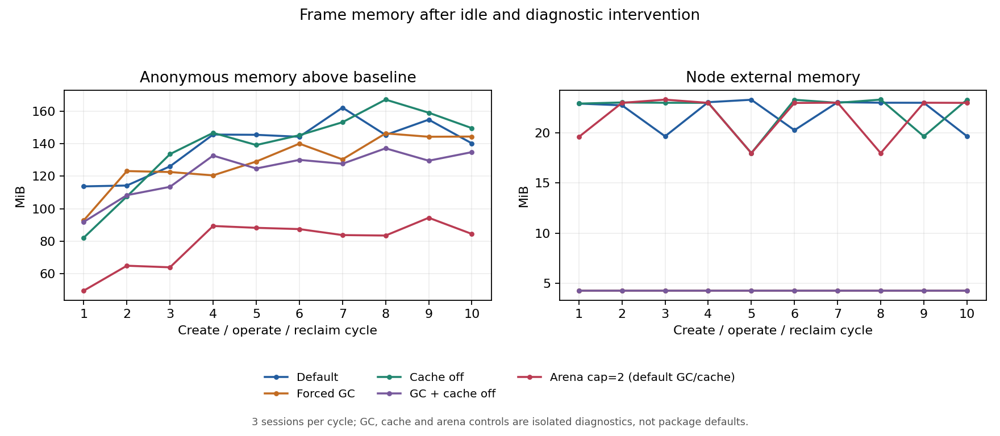

# frame 回收后内存归属调查

本轮对照用于解释[容量测试](2026-10-26-capacity.md)中浏览器退出后仍驻留的匿名内存。原容量实验的 3 秒 / 64MiB 回收预算保持不变；强制 GC、关闭缓存等诊断结果不能当作默认生产配置通过预算。

本轮结论：GC 与 sharp cache 都不能单独解释或消除驻留；限制 glibc arena 后，十轮末匿名内存由默认约 173MiB 降至 116MiB，但相对启动基线仍增长约 84MiB。宿主参数在原容量工作负载的单轮三会话检查中通过 64MiB 预算，十轮循环仍未达标。保留默认配置及预算，不宣称已解决长期泄漏或完成生产容量验收。调查同时修复了可复现的首帧更新遗漏。

## 固定实验与观测

- 四组独立进程：default、gc、cache-off、gc-cache-off。每组在同一 mirror 实例内连续建立/回收 10 轮，每轮 3 个 frame 会话。
- 每会话用真实客户端输入与 Enter 完成 10 次操作，每次都检查 DOM 结果、PNG 标记的实际画布像素和源站独立回执。每个源站会话序列必须恰好为 0–9；没有重试或补发业务操作。
- 每轮关闭客户端后保留服务端会话 3000ms，等待所跟踪的 Chromium 主进程关闭并从 `/proc` 消失，再空闲 3000ms。下一轮必须在回收完成后开始。
- 所有组均以 `node --expose-gc` 启动，以保持运行标志一致；只有 gc 和 gc-cache-off 在空闲后的 checkpoint 调用两次 GC，各等待一个 setImmediate。每组应累计 20 次诊断 GC，默认和仅关闭缓存组应为 0 次。
- cache-off 和 gc-cache-off 在创建 mirror 前调用 `sharp.cache(false)`；其余组保持默认配置。它只影响该隔离测试进程，不修改包的默认设置。
- 服务端 2 CPU / 2GiB，源站与客户端在另一容器，4 CPU / 4GiB；无宿主端口，internal 网络，每组有 420/450 秒超时和自动清理。

每 250ms 采样 Node heapUsed、heapTotal、RSS、external、arrayBuffers，V8 heap statistics、Node `/proc/self/status` 的匿名/文件 RSS、cgroup 匿名/文件/总内存、OOM、CPU，以及 sharp cache/counters。额外记录自然 GC 事件的次数和停顿。`arrayBuffers` 属于 `external` 的一部分，不能相加。

checkpoint 位于 baseline、beforeLaunch、postLaunch、active、detached、postClose、postIdle。GC 组同时保存干预前后值。观测器只保留 PID 和标量状态，不持有 Browser、Page 或 ChildProcess；运行时只追加小 checkpoint JSONL，结束后才序列化完整 trace，避免反复序列化增长中的 trace 制造额外 GC 压力。采样和标量记录仍有观测开销，因此不把小幅 heap 增长直接归因于引擎泄漏。

## 有效基线与首帧修复

第一次默认组在第 9 轮遭遇像素确认超时，实验按门槛停止，后续对照未启动。该不完整组单独留档，不混入完整结果。

随后[受控首帧回归](../acceptance/frame-baseline-2026-10-26.md)确认：第一张差分基准帧若已包含用户更新，旧实现没有把它下发，可能留下旧画面。修复为下发完整视口基准 tile 后，再用同一冻结工作负载重新开始全部四组。修复后的引擎摘要与初轮不同，容量历史报告不自动视为新版本的全面容量验收。

## 四组结果

四组各 10 轮均通过功能门槛：共 120 个独立源站会话、1200 次唯一操作；所有跟踪的 Chromium 主进程回收，无 OOM。以下为第 10 轮回收并空闲后、诊断干预后的 MiB；匿名增长以各进程启动 baseline 为基准。

| 组 | 匿名内存 | 匿名增长 | heapUsed | external | arrayBuffers | 末五轮匿名斜率 MiB/轮 |
| --- | ---: | ---: | ---: | ---: | ---: | ---: |
| default | 172.91 | 140.29 | 23.25 | 19.66 | 2.66 | -1.55 |
| gc | 176.88 | 144.49 | 14.87 | 4.27 | 0.46 | 2.27 |
| cache-off | 182.12 | 149.67 | 28.31 | 23.30 | 6.30 | 1.46 |
| gc-cache-off | 167.95 | 134.88 | 14.88 | 4.27 | 0.46 | 1.14 |

- GC 两组各执行 20 次诊断 GC，末轮 arrayBuffers 降到约 0.46MiB，但匿名内存仍约 168–177MiB。未释放的 JS Buffer 不是全部驻留的解释，强制 GC 也没有让匿名内存回到原预算。
- 默认 sharp 内存 cache 在回收 checkpoint 为 0，历史高水位约 6MB；关闭 cache 后匿名驻留没有明显改善，不能把默认的 50MB cache 上限直接当成实际占用。
- 所有 postIdle checkpoint 的 sharp queue/process 均为 0。Node 的 RssAnon 与 cgroup anon 接近，差约 0.1MiB；本轮回收后的主要驻留在 Node 进程中，不能归因于仍活跃的已跟踪 Chromium 主进程。
- 末五轮波动跨度约 9.5–22MiB，斜率并非全为零。十轮不能证明长期无泄漏，也不能仅凭 RSS 平台判定原生库泄漏。

运行时为 Node 24.21.0、glibc 2.36、sharp 0.35.5 / libvips 8.18.7，四组 sharp concurrency 均为 1。原环境没有配置 arena 上限、LD_PRELOAD 或加载 jemalloc。使用已缓存且固定依赖的隔离镜像，不代表本轮执行过标准 Dockerfile 的全新在线安装。

## 分配器补充组与处置

在四组全部结束后，另开独立进程，设置 `MALLOC_ARENA_MAX=2`，保持 sharp concurrency 为 1、默认 cache、无强制 GC，重复相同十轮。由于 arena 环境可能改变 sharp 默认线程数，诊断宿主显式调用 `sharp.concurrency(1)`，固定与原组相同的线程数；此改动仅在补充组镜像的诊断宿主中。引擎、客户端和工作负载摘要与四组一致。

补充组也完成 30 个源站会话 / 300 次唯一操作、浏览器回收和无 OOM。首轮匿名内存 81.13MiB，第十轮 116.12MiB，相对自身 baseline 增长 84.42MiB；末五轮斜率 0.47MiB/轮、跨度 10.97MiB。对照默认组第十轮 172.91MiB，末轮绝对驻留减少约 56.79MiB（32.8%）。这是一次顺序对照的观察量，不是统计置信区间或所有平台的预期收益。仍不能满足原 64MiB 回收增长预算。

该结果支持 glibc 分配器驻留/碎片是重要影响因素，但不定位到某个原生分配调用，也不排除长期泄漏。[sharp 官方性能说明](https://sharp.pixelplumbing.com/performance/)给出了 glibc 碎片与 arena 限制建议；[glibc 文档](https://sourceware.org/glibc/manual/latest/html_node/Memory-Allocation-Tunables.html)说明 arena 上限由进程启动配置控制。

保持依赖包默认行为：不强制 GC，不擅自关闭整个宿主的 sharp cache，不在导入包时修改分配器环境。Linux/glibc 宿主可在独立实例中评估以下启动配置，并重新测量其吞吐和内存：

```bash
MALLOC_ARENA_MAX=2 VIPS_CONCURRENCY=1 node app.js
```

`VIPS_CONCURRENCY=1` 保持本实验的 libvips 并发值；本地另验该环境下 `sharp.concurrency()` 为 1。其他 sharp 用户共享进程时需由宿主统一选择配置，不把此诊断值当成通用最优值。

另以仅设置 `MALLOC_ARENA_MAX=2 VIPS_CONCURRENCY=1` 的宿主镜像，执行原容量工作负载的单轮三会话用例：3 次 warmup + 20 次测量 / 会话。该轮全部预算通过：冷启动最慢 2366ms、最差用户绘制 p95 64.80ms、服务端峰值 776.35MiB、回收后匿名增长 56.36MiB、无 OOM。此处不使用显式 `sharp.concurrency(1)` 补丁，也不暴露或调用 GC；该结果与十轮复用实例的超预算必须同时报告，不能升级为默认配置或长期容量验收。

同一修复引擎、默认环境的单轮三会话对照：冷启动最慢 2451ms、绘制 p95 48.50ms、峰值 833.11MiB、回收后匿名增长 127.91MiB；功能通过且无 OOM，但回收预算失败。两组源码摘要一致，仅宿主环境不同。各一轮、顺序执行，不能据此宣称延迟提升；参数组本轮 p95 更高。两组详细结果纳入机器可读汇总。



[机器可读汇总](2026-10-26-frame-memory-summary.json)包含逐轮值、冻结计划、镜像 ID、代码摘要及补充组。原始日志在本机 `/home/Kei/dom-mirror-validation/20261026/frame-memory-fixed/` 与 `frame-memory-arena/`，不随 npm 包附带。初轮失败记录仍独立保存于 `frame-memory/`，不计入以上 50 轮 / 1500 次操作。

## 修复后业务回归与后续门槛

同一修复引擎镜像另行完成 Vikunja frame 的登录、创建任务、优先级修改与完成流程，UI/API 持久化断言通过；DOM 与 frame 的短时断线恢复、已提交操作不重放、同账号会话隔离、过期与显式重建均通过。固定应用版本、镜像 ID 和逐项结果保存在机器可读汇总，原始截图/日志分别在本机 `frame-memory-business-core/` 与 `frame-memory-business-recovery/`。这些是本地隔离验证，不代表远端 CI 或生产业务验收。

Node 27 项测试、脚本编译、tarball 独立宿主安装及 CI actionlint 检查通过；受控首帧新旧实现对照见专门验收记录。没有修改库默认 GC/cache/分配器行为，也没有提高会话上限。

后续先固定候选宿主配置，延长连续建连/回收并观察 native 驻留是否持续增长；超预算时进一步跟踪原生分配归属。再以真实业务并发和完整容量矩阵复验原预算。当前不能承诺三会话长期稳定容量，单轮通过不免除十轮未达标。

## 复现

```bash
docker build -t dom-mirror:local .
IMAGE=dom-mirror:local EVIDENCE_DIR="$PWD/artifacts/frame-memory/run-1" \
  bash tools/run-memory-matrix.sh
```

单组：

```bash
IMAGE=dom-mirror:local MEMORY_GROUP=cache-off \
  EVIDENCE_DIR="$PWD/artifacts/frame-memory/cache-off" \
  bash tools/verify-docker-memory.sh
```

分配器补充组需要在另一个镜像中、启动 Node 前设置环境；保持原组缓存和 GC 行为。以下环境版本经单独宿主配置检查（诊断组实际通过显式 `sharp.concurrency(1)` 固定相同线程数）：

```dockerfile
FROM dom-mirror:local
ENV MALLOC_ARENA_MAX=2 VIPS_CONCURRENCY=1
```

以新标签构建该镜像后，使用 `MEMORY_GROUP=default` 和新的证据目录执行单组命令；不要覆盖原组，先确认 `server.json` 中 `sharpConcurrency` 为 1。

所有组完成后，`tools/summarize-memory.cjs` 生成每轮 checkpoint、末五轮斜率/跨度、GC 次数、内存与来源证据。缺少有效数据、功能失败、浏览器未回收或 OOM 时不会标为完整。

手动绘图（matplotlib 是可选分析依赖，非 Node 包运行依赖）：

```bash
python3 tools/plot-frame-memory.py artifacts/frame-memory/run-1/summary.json \
  artifacts/frame-memory/run-1/memory.png
```

结果只覆盖十轮、低频合成看板和指定运行时；没有持续增长只能表示本轮未观察到该现象。不得据此证明长期无泄漏。`sharp.cache` 与强制 GC 都是进程级行为，未经宿主选择，不应由嵌入库擅自调整整个宿主的缓存或强制 GC。

后续三十轮重复回收、glibc 全部 arena 状态和末尾 GC/trim 分离诊断见[续测记录](2026-10-26-frame-memory-long.md)。原十轮数据与判定保持不变。
