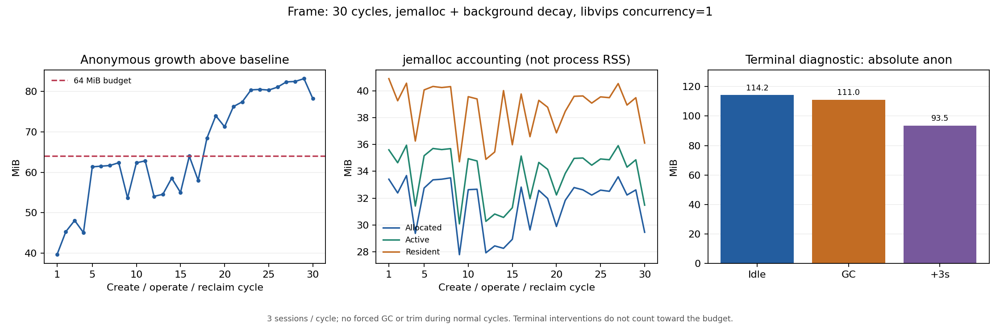

# jemalloc 候选宿主：三十轮与真实业务验收

本轮将[十轮宿主配置对照](2026-10-26-allocator-mappings.md)中的 jemalloc 候选配置延长为三十轮，再验证相同配置下的真实业务与恢复。原 64MiB 正常回收增长预算保持不变，末尾诊断 GC 不回填正常轮次的结果。

## 实测结果

**候选配置未通过全部轮次的正常内存预算，暂不推荐为默认或生产准入配置。** 三十轮共 900 次操作 / 90 个独立源站会话全部通过，全部跟踪 Chromium 主进程退出，无 OOM。正常回收预算通过 **17/30 轮**；第 18 轮首次超过 64MiB，随后各轮均超限。不能用先前十轮通过推导更长运行也通过。

| 指标 | 结果 |
| --- | ---: |
| 启动匿名内存 baseline | 35.21MiB |
| 第三十轮正常回收匿名内存 | 113.39MiB |
| 第三十轮较 baseline 增长 | 78.17MiB |
| 正常轮次最大增长 | 83.10MiB |
| 最后十轮斜率 / 区间跨度 | +0.451MiB/轮 / 6.89MiB |
| 服务端 cgroup 峰值（含源站浏览器） | 892.49MiB |
| 完整实验观测时长（含末尾诊断） | 569.73 秒 |



末尾额外空闲 15 秒后匿名内存为 114.20MiB；两次诊断 GC 后为 111.01MiB，再空闲三秒为 93.54MiB。末尾 GC 区间记录到两次 GC，ArrayBuffer 从 4.50MiB 降为 0.52MiB，jemalloc allocated 从 30.25MiB 降为 10.95MiB；后续三秒 resident 从 37.22MiB 降为 17.82MiB。这支持工作负载结束后的可回收内存及延迟归还确实参与驻留，但 GC 与后台回收交叠，不能将全部下降单独归因于某一个动作。诊断后的增长约 58.32MiB 不计入正常预算。

finalSettled 完整 smaps 的匿名合计约 93.62MiB，其中无名非执行映射 89.91MiB、无名执行映射 2.59MiB、文件映射中的匿名页 1.04MiB、主栈 0.07MiB；V8 total_physical_size 约 25.28MiB，jemalloc resident 约 17.82MiB。几项口径不能直接相加或相减推导剩余内存的所有者；仍缺分配调用栈/映射生命周期归因。观测器自身也保留随轮次增加的记录，本次不据此宣称库持续泄漏或已达平台期。

[机器可读汇总](2026-10-26-jemalloc-candidate-summary.json)保留三十个 checkpoint、独立末尾诊断、预检、映射/V8 快照摘要及工具哈希。九项测量源码与上一轮十轮配置对照完全一致；结果是独立样本，不能将旧 glibc 三十轮与本轮绝对值差当作同时对照的因果收益。

## 真实业务结果

固定 Vikunja v2.7.1（镜像 digest 见汇总），在上述三十轮容器完全退出后顺序运行两组：

| 验证 | 结果 |
| --- | --- |
| 直连 / DOM / frame：登录、创建任务、Medium、完成及独立 API 持久化确认 | 3/3 通道通过 |
| DOM / frame：短时恢复、已提交操作不重放、同账号会话隔离、过期及显式重建 | 2/2 通道、各四项通过 |
| 核心流程源站 Chromium 主进程 | 2/2 在删除容器前退出 |
| 恢复流程源站 Chromium 主进程 | 6/6 在删除容器前退出 |

两组宿主实际报告 jemalloc、sharp concurrency=1，所有跟踪 Chromium 均未映射 jemalloc；服务端/客户端无 OOM，核心源码摘要与本次长测一致。功能及生命周期通过不抵消三十轮内存预算失败，也不等于业务并发容量验收。合成账号/本地应用与显式关闭混淆的范围见下文。

## 冻结协议

- 三十轮、每轮三会话、每会话十次真实 Enter 操作，预期 90 个独立源站会话 / 900 条唯一回执。每次检查 DOM、实际画布标记与源站独立回执，不重试或重放操作。
- 每轮等待 3000ms 会话保留期、所有跟踪 Chromium 主进程退出，再空闲 3000ms；正常轮次没有强制 GC、trim 或关闭 cache。
- 镜像服务 2 CPU 配额 / 2GiB，独立压测端 4 CPU / 4GiB。internal 网络，无宿主端口。沿用同样的原生统计、250ms 采样和标量浏览器跟踪；在 baseline、第三十轮和 finalSettled 保存完整映射与 V8 数据。
- 固定 `MALLOC_ARENA_MAX=2 VIPS_CONCURRENCY=1`，preload Debian `libjemalloc2=5.3.0-1`，`MALLOC_CONF=narenas:2,background_thread:true,dirty_decay_ms:1000,muzzy_decay_ms:1000`。
- 全部三十轮结束后额外空闲 15 秒，调用两次诊断 GC，再空闲三秒。没有 trim。全部组以 `--expose-gc` 启动；正常回收预算只看三十个 postIdle checkpoint。
- 独立短进程先以 64MiB 存活 Buffer 校验 jemalloc allocated 统计增加。正式源站 Chromium 清空 preload/conf，核对真实进程 maps。观测器保留采样及标量记录，有随轮数增长的开销；不把小幅 heap 增长直接判为库泄漏。

实际计划在启动前写入只创建一次的 `plan.json`，包含完整参数及九项源码摘要。与十轮对照的测量源码一致，沿用固定依赖镜像，仅复制新增工具；不是标准 Dockerfile 的全新在线安装，也不是独占宿主 CPU 或生产长稳试验。

## 真实业务的宿主边界

使用独立本地 Vikunja、SQLite、合成账号和任务，不接入已有业务或真实凭据。先直连，再 DOM/frame 完成登录、创建任务、优先级 Medium、完成任务，继续以应用 API 独立确认持久化。另验证 DOM/frame 的短时恢复、已提交操作不重放、同账号会话隔离、过期与显式重建。

宿主为 `tools/allocator-business-host.cjs`，只通过公开的 `createMirror`、HTTP/WS 接入与 `launchOptions.env` 配置。其 Node 使用候选 allocator，Chromium 明确清空 `LD_PRELOAD`/`MALLOC_CONF` 并检查实际 maps。该宿主显式关闭字体混淆，不作为混淆功能或真实账号提供方的验收。业务运行不暴露 GC，也不主动回收 allocator cache。

服务端 2 CPU 配额 / 2GiB；Vikunja 1 CPU / 768MiB；客户端 2GiB、未设置 CPU 配额。固定 `SESSION_GRACE_MS=2000` 用于回收和过期测试。业务结束后，在删除容器前轮询宿主状态，确认所有实际启动的源站浏览器主进程已关闭并消失；不能只凭容器被删除判定回收成功。业务验证只判断功能与资源生命周期，不把它当成业务场景内存/时延预算验收。

复现同样的 Node/Chromium allocator 分界，宿主可使用现有配置：

```js
const mirror = createMirror({
  originUrl: 'http://your-private-application/',
  launchOptions: {
    env: { ...process.env, LD_PRELOAD: '', MALLOC_CONF: '' },
  },
});
```

这不是包的默认 allocator 策略，也没有新增公共 API。

## 复现

```bash
docker build -t dom-mirror:local .
docker build -f tools/Dockerfile.allocator --build-arg BASE_IMAGE=dom-mirror:local \
  -t dom-mirror:allocator .
IMAGE=dom-mirror:allocator EVIDENCE_DIR="$PWD/artifacts/jemalloc-thirty/run-1" \
  bash tools/run-jemalloc-long.sh

BUSINESS_ALLOCATOR_PROFILE=jemalloc SESSION_GRACE_MS=2000 \
  IMAGE=dom-mirror:allocator EVIDENCE_DIR="$PWD/artifacts/jemalloc-business/core" \
  bash tools/verify-docker-vikunja.sh
BUSINESS_ALLOCATOR_PROFILE=jemalloc BUSINESS_TEST_SCRIPT=verify-recovery.cjs \
  SESSION_GRACE_MS=2000 IMAGE=dom-mirror:allocator \
  EVIDENCE_DIR="$PWD/artifacts/jemalloc-business/recovery" \
  bash tools/verify-docker-vikunja.sh
```

统计中的 `complete` 表示实验数据/功能门槛完整，资源预算见 `normalCleanupBudget`。jemalloc allocated/active/resident 不等于整个 Node RSS，mapped/retained 不等于物理泄漏；V8 heap-space 也不能与重叠映射直接相加。

## 处置与下一步

保留当前包默认行为与原 64MiB 预算，不增加 Rust/Wasm、进程级定时 GC 或 allocator 默认切换。下一步应针对第 18 轮前后的驻留增长做分配调用栈与映射生命周期归因，并评估低保留量观测方式，先区分业务存活对象、观测器开销与原生空闲页；再决定是否需要改库。宿主安装产物的浏览器业务与恢复验收仍是独立交付缺口，本轮源码镜像中的公开 API 验证不代替 tarball 宿主验收。

后续[第十八轮增长的离线分析与减留存诊断工具](2026-10-26-memory-growth.md)发现该区间的 V8 physical 同步增加；根因仍未证明，尚未运行新模式长测，原预算结果保持不变。
