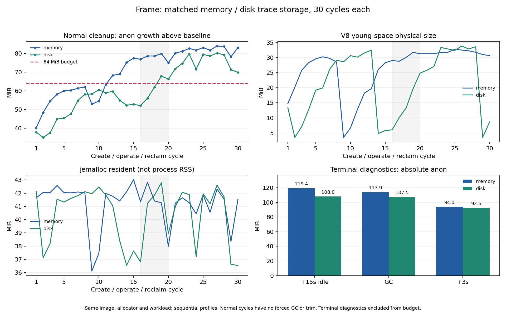
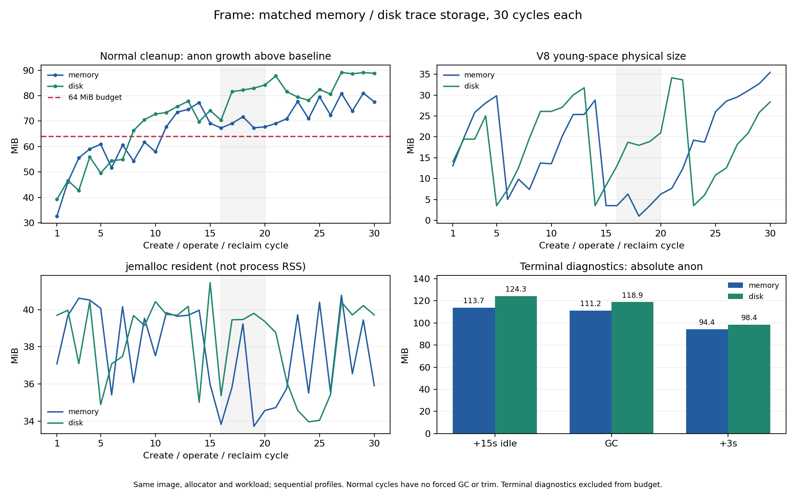

# 观测器留存配对与反序复验

[上一轮离线分析](2026-10-26-memory-growth.md)补好了落盘模式，本轮实际执行同一镜像、同一套工具下的 memory/disk 配对，并反序重复。**日志落盘不构成这次内存预算问题的修复：四组均未全部通过原 64MiB 正常回收预算，收益方向也未稳定重现。**

四组共 120 轮 / 360 个独立源站会话 / 3600 条唯一操作回执全部通过，每个源站会话只收到索引 0—9；所有跟踪 Chromium 主进程都在下一轮前退出，无 OOM。这里的功能/数据完整，不表示资源预算或生产准入通过。

## 实测

增长量均以各进程启动 baseline 为基准，单位 MiB。P95 为每次 arm 至 DOM 与画布/rAF 均确认的时间，只作本次记录的描述统计，不是完整业务端到端或冻结时延预算验收。

| 配对 | 顺序中的模式 | 正常预算通过 | 末轮匿名增长 | 最大匿名增长 | 双确认 P95（ms） |
| --- | --- | ---: | ---: | ---: | ---: |
| 1 | memory | 11/30 | 83.11 | 83.98 | 87.2 |
| 1 | disk | 18/30 | 69.84 | 80.14 | 97.1 |
| 2 | disk | 7/30 | 88.79 | 89.16 | 101.7 |
| 2 | memory | 10/30 | 77.59 | 80.99 | 96.3 |

第一轮 disk 的末轮增长低于 memory，反序后 disk 反而更高；每种模式只有两个独立运行，不能给出稳定效应大小或长期无泄漏的结论。可以明确的是：移除 trace 数组历史记录不足以让当前候选宿主满足原预算。memory 模式仍保留采样/GC/checkpoint，disk 模式服务端这三个数组为空，完整记录离线读回；两者都保留浏览器标量状态。





两图颜色分别表示存储方式，各图对应一个独立配对。阴影是额外完整映射的采样轮次，不是固定故障阈值。jemalloc resident 与 V8 physical 不能相加推算所有驻留归属；末尾 GC 与空闲不能回填正常预算。

## 冻结条件与审计

- 每组 30 轮，每轮 3 会话，每会话 10 次真实 Enter，保持原操作频率和 DOM/像素/源站独立回执检查，不重试或重放业务操作。
- 每轮等待 3000ms 保留期、所跟踪浏览器主进程退出，再空闲 3000ms；正常轮次没有强制 GC、trim 或关闭 sharp cache。
- 镜像服务 2 CPU / 2GiB，独立压测端 4 CPU / 4GiB，internal 网络、无宿主端口。配额不等于独占宿主资源。
- 四组共用 `sha256:5e6314b43f804a745a2dfa2bac036e9f309bdf853e87b01c1083b7b6283d92c5`，十项测量源码与原生探针二进制一致；同一配对的计划只有 traceStorage 不同。基于已固定依赖镜像复制工具，不是全新在线安装。
- 固定 jemalloc preload/decay、arena=2、libvips concurrency=1。独立 64MiB 活 Buffer 预检通过；所有源站 Chromium 的真实 maps 均未包含 jemalloc。
- baseline、第 16—20 轮 postIdle、末轮和 finalSettled 保存完整 smaps/V8。三十轮之后另空闲 15 秒、两次诊断 GC、再空闲三秒；没有 trim。
- 先 memory→disk，再 disk→memory。已核对四个容器服务时间窗，均按顺序运行；全部容器退出，无 OOM，CPU/内存配额与计划一致。

[机器汇总](2026-10-26-trace-storage-summary.json)保留全部 checkpoint 指标、逐轮 V8 分区、映射分类、留存计数、预检、时间窗、镜像及源码摘要。原始大日志位于其中记录的本地 evidenceRoots；不将旧数据重编码的兼容性验证算成新测量。

## 复现

先用当前源码构建普通镜像与可选 native-probe 镜像，再用两个不同目录、相同镜像顺序执行以下两组，并在新的根目录反序重复。每个 runner 都会在工作负载开始前冻结不可覆盖的计划。

```bash
docker build -t dom-mirror:local .
docker build -f tools/Dockerfile.allocator --build-arg BASE_IMAGE=dom-mirror:local \
  -t dom-mirror:trace-pair .
MEMORY_TRACE_STORAGE=memory MEMORY_MAP_CYCLES=16,17,18,19,20 \
  IMAGE=dom-mirror:trace-pair EVIDENCE_DIR="$PWD/artifacts/pair/memory" \
  bash tools/run-jemalloc-long.sh
MEMORY_TRACE_STORAGE=disk MEMORY_MAP_CYCLES=16,17,18,19,20 \
  IMAGE=dom-mirror:trace-pair EVIDENCE_DIR="$PWD/artifacts/pair/disk" \
  bash tools/run-jemalloc-long.sh
```

`tools/summarize-trace-pair.cjs ROOT` 还需要 ROOT/protocol.json 声明实际顺序（`order`）和 `docker image inspect --format '{{.Id}}' IMAGE` 得到的镜像 ID（`mirrorImage`）；然后校验计划、源码、二进制、配额、实际时间窗与功能计数，拒绝不一致的比较。机器汇总中的两个 protocol 可作为格式示例，但复验须写入自己的镜像 ID。

## 处置

保留原预算和包默认行为，保留两个观测模式用于可重复调查，不将 disk 设为所谓内存修复。V8 分区统计仍无法解释全部剩余驻留，因此继续以独立、显式启用的 V8 GC/页池诊断核对缓存页及帧载荷；诊断日志会改变运行开销，不能替代未插桩的验收。

后续[页池诊断、关闭额外诊断的宿主参数对照与真实业务验收](2026-10-26-v8-memory.md)已完成；semi-space=4 是本轮验证有效的宿主配置，原四组失败判定保持不变。
