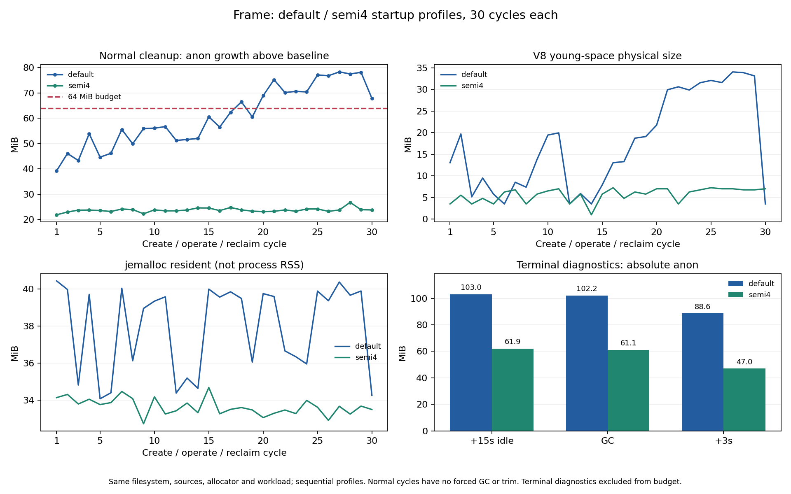

# V8 页池与宿主参数验证

本轮接续[观测器存储配对](2026-10-26-trace-storage.md)。四组反序试验均未全部满足原预算，不能把日志落盘当作修复。本报告先记录独立 GC/页池诊断，再通过关闭额外 GC 日志和帧长度探针的配对验证宿主参数；两者的作用不同，不将诊断组通过当成生产验收。

## 实测结论

**在本轮固定三会话负载中，显式限制宿主 semi-space 到 4MiB 通过了三十轮原预算。** 默认配置只通过 18/30 轮，候选通过 30/30 轮；两组各 900 次操作 / 90 个源站会话与浏览器回收均通过，无 OOM。公共库默认配置和引擎代码保持不变，没有加入定时 GC 或 Rust/Wasm。

| 指标 | 默认 semi-space | `--max-semi-space-size=4` |
| --- | ---: | ---: |
| 启动 baseline 匿名内存（MiB） | 35.82 | 38.63 |
| 末轮正常回收匿名内存（MiB） | 103.64 | 62.46 |
| 末轮较 baseline 增长（MiB） | 67.83 | 23.83 |
| 正常轮次最大增长（MiB） | 78.27 | 26.80 |
| 原 64MiB 正常预算通过 | 18/30 | 30/30 |
| 服务端 cgroup 峰值（MiB，含源站 Chromium） | 843.82 | 797.67 |
| DOM 确认 P95（ms，预算 500） | 68.5 | 68.4 |
| 画布/rAF 确认 P95（ms，预算 1000） | 84.7 | 82.7 |
| young generation 最大容量 / physical（MiB） | 64 / 34.03 | 8 / 7.26 |
| GC 事件记录数（含不同阶段，非完整 GC 次数） | 1909 | 2095 |
| 最大 GC 暂停记录（ms） | 59.2 | 82.8 |
| 正常窗口 cgroup CPU（秒，含源站浏览器） | 213.06 | 213.26 |



两组原交互与峰值预算均通过；候选正常匿名内存的最大增长距 64MiB 仍有约 37.2MiB。候选增加了 GC 事件记录，最大暂停更高，因此不宣称全面提速或所有尾延迟均无退化；这也是宿主参数必须由实际业务验收的原因。CPU 数值接近只是本次固定一秒节奏负载的描述，不是饱和吞吐量结论。

候选最后十轮的匿名内存斜率仍为 +0.127MiB/轮、区间跨度 3.54MiB；一次三十轮对照不是多日长稳或无泄漏证明。V8 young generation 的容量/驻留以及对象回收时机是已验证的有效调优方向，尚未把全部 RSS 按调用栈精确分配到所有者。

[参数对照机器汇总](2026-10-26-v8-host-summary.json)保留两组计划、镜像配置及相同 RootFS、实际 Node 参数、原生二进制、源站回执检查、全部正常 checkpoint 与独立末尾诊断。候选末尾 GC 后再空闲三秒为 47.04MiB，**这个值没有计入正常预算**。

## 真实业务与资源生命周期

同一候选镜像上的公开 `createMirror` 宿主通过了本地 Vikunja v2.7.1（固定 digest）、SQLite 与合成账号/任务验收：

- 直连 / DOM / frame 的登录、创建任务、优先级 Medium、完成，均由 UI 执行并以独立应用 API 确认持久化。
- DOM / frame 的短时恢复、已提交操作不重放、同账号会话隔离、过期与显式重建全部通过。
- 核心流程 2 个、恢复流程 6 个源站 Chromium 主进程，在删除容器前均已关闭、断开并从 `/proc` 消失，实际 maps 均未加载 jemalloc。
- 宿主实际 `process.execArgv` 包含 semi-space=4，无 `--expose-gc` 或 GC 日志参数；原生 allocator 实际为 jemalloc、sharp concurrency=1。客户端没有注入该 Node 参数。

服务端 2 CPU / 2GiB，Vikunja 1 CPU / 768MiB，客户端 2GiB 且无 CPU 配额，SESSION_GRACE_MS=2000。两组服务端与客户端无 OOM。此宿主显式关闭字体混淆，只验证功能及生命周期；不是业务内存/时延预算、真实身份提供方或 tarball 浏览器宿主验收。

## 宿主接入方式与边界

该配置是经过上述限定负载验证的宿主选项，不是依赖包默认设置。测试环境为 Linux x86_64、Node v24.21.0、glibc 2.36、Debian jemalloc 5.3.0-1、sharp 0.35.5 / libvips 8.18.7。其他平台、运行时版本、同进程负载和会话数需要独立验收。

拥有 Node 启动方式的宿主可按以下方式显式配置；不要将参数动态写入使用者的全局环境：

```bash
MALLOC_ARENA_MAX=2 VIPS_CONCURRENCY=1 \
LD_PRELOAD=/usr/lib/x86_64-linux-gnu/libjemalloc.so.2 \
MALLOC_CONF=narenas:2,background_thread:true,dirty_decay_ms:1000,muzzy_decay_ms:1000 \
node --max-semi-space-size=4 your-host.cjs
```

为复现测试中的 Node/Chromium 分界，宿主还需使用已有的公开配置清空源站 Chromium 的 allocator 环境：

```js
const mirror = createMirror({
  originUrl: 'http://your-private-application/',
  maxSessions: 3,
  launchOptions: {
    env: { ...process.env, LD_PRELOAD: '', MALLOC_CONF: '' },
  },
});
```

HTTP/WS 挂载和关闭方式沿用[最小宿主示例](../../examples/host.cjs)。本轮没有调整包的默认会话上限或引入新公共选项；进程级 Node 参数应由宿主拥有者选择，不能由某个镜像实例替整个 Node 应用决定。完整容量矩阵、多日长稳、真实账号与打包产物浏览器业务仍属后续准入范围。

## 独立诊断

固定 Node v24.21.0 / V8 13.6.233.17-node.53，在隔离宿主显式启用 `--trace-gc --trace-gc-verbose`，同时只落盘记录 screencast 编码长度与时间，不保留帧正文。

实际完成 300 次操作、30 个源站会话/浏览器回收，无 OOM。全进程日志中 V8 页池 committed 最大为 **65.50MiB**；共记录 **1118 个帧事件**，编码字符串平均 158507 字符、最大 160172 字符。

Node 对应版本的 [V8 分配器源码](https://github.com/nodejs/node/blob/v24.21.0/deps/v8/src/heap/memory-allocator.cc)存在将回收 chunk 缓存到页池的路径，供后续复用；[页池源码](https://github.com/nodejs/node/blob/v24.21.0/deps/v8/src/heap/page-pool.cc)也区分缓存、复用与实际释放。这与“JS 对象已回收，但进程仍保有内存”的机制相符。**页池 committed 不是 resident，不能将它直接加到 V8 physical 或 jemalloc resident 上，也不能据此把全部 RSS 差额归给页池。**

末尾 15 秒空闲后匿名内存 103.30MiB；两次诊断 GC 后为 98.12MiB，再空闲三秒为 77.73MiB。诊断组正常预算通过 10/10 轮，但 GC 日志和帧长度探针改变了运行环境与开销，该结果不能代替未插桩三十轮验收，也不是原失败被修复的证明。

[独立诊断机器汇总](2026-10-26-v8-pool-summary.json)保存完整页池计数、启动参数、帧长度统计、源码摘要、逐轮与末尾诊断。

## 关闭额外诊断后的参数对照协议

- 基线与候选各 30 轮 / 90 个独立会话 / 900 次操作。两个镜像的 RootFS layers、引擎与探针源码、原生二进制一致，仅服务端 Node 启动参数改变为 `--max-semi-space-size=4`；两组均关闭 GC 日志与帧长度探针，记录实际 `process.execArgv`；仍保留两组相同的原生统计、250ms 采样与 disk 日志。
- 相同 jemalloc/decay、arena=2、libvips concurrency=1、默认 sharp cache、disk trace storage、资源配额及原三秒正常回收判定。保留原 64MiB 匿名增长预算、1638.4MiB 峰值参考、DOM P95 500ms、画布/rAF P95 1000ms，不调整阈值。
- 正常轮次不强制 GC、不 trim。全部轮次之后的两次 GC 和空闲单独列出。源站 Chromium 不继承 jemalloc，客户端 Node 不注入 semi-space 参数。
- 两组顺序运行，各 runner 在开始前冻结计划、镜像 ID、源码/引导程序摘要；比较时核对实际启动参数、计数、退出状态、资源配额与时间窗。
- 交互统计使用原合成 fixture 的 arm→DOM 与 arm→画布/rAF 确认，不替代完整业务端到端、冷启动或完整容量矩阵验收。

Node 的 [semi-space 参数说明](https://github.com/nodejs/node/blob/v24.21.0/doc/api/cli.md)明确提示内存与吞吐之间需要实际测试。参数属于宿主 Node 进程，会影响同进程的其他代码，不能由一个嵌入库擅自修改。本轮不改变包默认 allocator、GC、cache 或公共 API。

## 复现工具

```bash
# BASE_IMAGE 需为已经显式编译 native-memory.node 的 allocator 诊断镜像。
docker build -f tools/Dockerfile.v8-memory --build-arg BASE_IMAGE=dom-mirror:allocator \
  -t dom-mirror:v8-pool .
IMAGE=dom-mirror:v8-pool MEMORY_CYCLES=10 \
  EVIDENCE_DIR="$PWD/artifacts/v8/pool" bash tools/run-v8-memory.sh

docker build -f tools/Dockerfile.v8-memory --build-arg BASE_IMAGE=dom-mirror:allocator \
  --build-arg V8_TRACE=0 -t dom-mirror:v8-default .
docker build -f tools/Dockerfile.v8-memory --build-arg BASE_IMAGE=dom-mirror:allocator \
  --build-arg V8_TRACE=0 --build-arg MAX_SEMI_SPACE=4 -t dom-mirror:v8-semi4 .
IMAGE=dom-mirror:v8-default MEMORY_CYCLES=30 \
  EVIDENCE_DIR="$PWD/artifacts/v8/default" bash tools/run-v8-memory.sh
IMAGE=dom-mirror:v8-semi4 MEMORY_CYCLES=30 \
  EVIDENCE_DIR="$PWD/artifacts/v8/semi4" bash tools/run-v8-memory.sh
```

`tools/summarize-v8-memory.cjs` 校验实际引导程序哈希、参数、功能与资源边界，并解析 GC 页池日志。`tools/summarize-v8-pair.cjs ROOT` 读取运行前冻结的 protocol（两个镜像的实际 ID/RootFS、顺序与预算），验证相同文件系统/源码及唯一参数差异；配对计划的实际例子随最终机器汇总保留。构建产物与源码须对应，工具会拒绝镜像中的引导程序与工作区计划摘要不一致。

## 工具与交付检查

本地 30 项 Node 测试、语法检查、独立 tarball 宿主安装、bash 语法及 actionlint 通过。使用有效配对数据的负对照确认：缺一条回执计数、加入额外启动参数或改变候选 RootFS，比较器均拒绝通过；不只信任 `complete=true`。普通包入口不加载诊断引导程序，不自动安装 jemalloc、不添加进程信号或全局 VM 设置。浏览器长测与真实业务是本地独立验收，远端 CI 范围以对应提交工作流为准。
